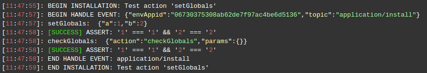
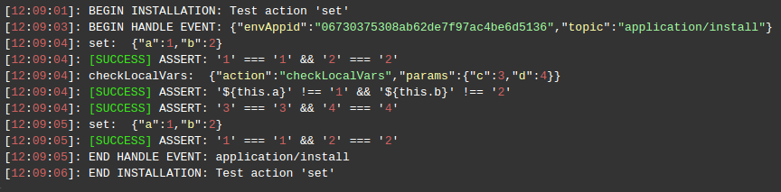
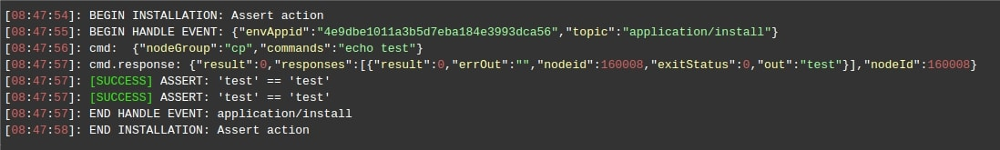
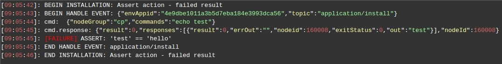
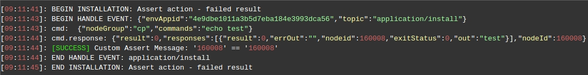
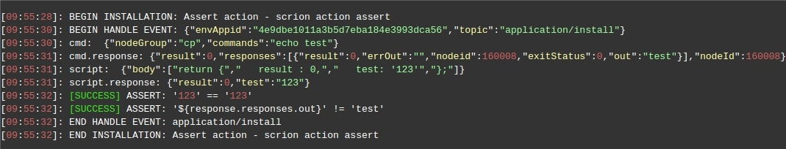
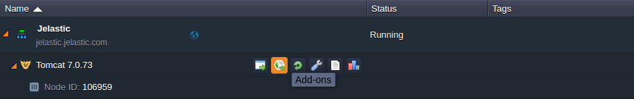
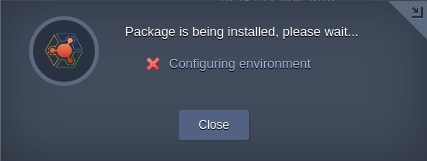
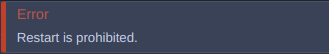
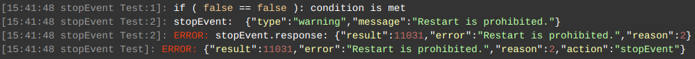

# Actions

Actions represent a scripted logic for executing a set of commands to automate the tasks. The system provides a default list of actions and possibility to [script custom actions](/custom-scripts/) using [API calls](https://docs.jelastic.com/api/), Linux bash shell command, JS, and Java scripts. Any action, available to be performed by means of API (including custom scripts running), should be bound to some [event](/events/) and executed as a result of this event occurrence.                                                      

With the help of actions you can achieve automation of the tasks related to:                

- increasing or decreasing CPU or RAM amount                    
- adjusting essential configs                                
- restarting a service or a container                             
- applying a database patch                                                   

The default workflow for any action execution is the following:                  

- replacing [placeholders](/placeholders/)                                     
- getting a list of [target containers](/selecting-containers/)                                                 
- checking permissions                                     
- executing the action itself                                                   

Thus, the following specific groups of actions are singled out:           

- [Container Operations](#container-operations)                   
- [Topology Nodes Management](#topology-nodes-management)             
- [Database Operations](#database-operations)                   
- [User-Defined Operations](#user-defined-operations)              
- [Custom Actions](#custom-actions)                                             

## Container Operations

There are actions that perform operations inside of a container. For a detailed guidance on how to set a target container, visit the [*Specifying Target Containers*](/selecting-containers/) page.                        

Any container operation can be performed using a [*cmd*](#cmd) action. Moreover, there are also some additional actions provided for your convenience. Thus, all the actions performed in confines of a container can be divided into three groups:       

- SSH commands ([*cmd*](#cmd))                            
- predefined modules ([*deploy*](#deploy), [*upload*](#upload), [*unpack*](#unpack))                                
- operations with files ([*createFile*](#createfile), [*createDirectory*](#createdirectory), [*writeFile*](#writefile), [*appendFile*](#appendfile), [*replaceInFile*](#replaceinfile))                                     

{}
To process any container operation (except for [*cmd*](#cmd)), the Cloud Scripting engine applies a default system user with restricted permissions.                       
{}

### cmd

The *cmd* action executes *[commands](https://www.virtuozzo.com/application-management-docs/ssh-gate/)* in synchronous and asynchronous modes. Within one container the *cmd* actions can be performed in synchronous mode only. Within one environment *cmd* actions can be performed asynchronously in case similar actions are required to be executed on different nodeGroups.
<!--Available for all nodes.-->      

**Example** 


```yaml
cmd [nodeId,nodeType,nodeGroup]:
  - cmd1
  - cmd2
sayYes: true
```


```json
{
  "cmd [nodeId,nodeType,nodeGroup]": [
    "cmd1",
    "cmd2"
  ],
  "sayYes" : true
}
```



where:       
     
- `nodeId`, `nodeGroup`, `nodeType` - parameters that determine target containers for the action execution (at least one of these parameters is required)                                                
- `cmd1` and `cmd2` - set of commands that are executed. Their values are wrapped by the Cloud Scripting engine via **echo cmd | base64 -d | su user** where:                    
    - **cmd** - is equal to the Base64 encoded string: **yes | (cmd1;cmd2)**. If your commands require the interactive input, by default, the Cloud Scripting engine always gives a positive answer, using **yes** utility.        
    - **user** - default system user with restricted permissions    
- `sayYes` *[optional]* - parameter that enables or disables the usage of **yes** utility. The default value is *'true'*.                  

The single SSH command can be passed in a string. For example, running a bash script from URL on all **Tomcat 6** nodes asynchronously.                    


```yaml
cmd [tomcat6]: curl -fsSL http://example.com/script.sh | /bin/bash -s arg1 arg2
```


```json
{
  "cmd [tomcat6]": "curl -fsSL http://example.com/script.sh | /bin/bash -s arg1 arg2"
}
```



The same action can be performed asynchronously on all nodes of specific *[nodeGroup](https://www.virtuozzo.com/application-management-docs/paas-components-definition/#layer)* or several ones provided as the list: [cp, bl].  


```yaml
cmd [cp, bl]: curl -fsSL http://example.com/script.sh | /bin/bash -s arg1 arg2
```


```json
{
  "cmd [cp, bl]": "curl -fsSL http://example.com/script.sh | /bin/bash -s arg1 arg2"
}
```



If necessary *cmd* action can be executed on all nodes of all available nodeGroups within one environment. Action will be performed asychronously as well.  


```yaml
cmd [*]: curl -fsSL http://example.com/script.sh | /bin/bash -s arg1 arg2
```


```json
{
  "cmd [*]": "curl -fsSL http://example.com/script.sh | /bin/bash -s arg1 arg2"
}
```




The default `cmd` parameter is **commands**. It can be useful to set a several commands in the same `cmd` action. For example:



```yaml
type: update
name: Cmd commands

onInstall:
  cmd:
    - echo 'Hello ' >> /tmp/CmdResponse.txt
    - echo 'World ' >> /tmp/CmdResponse.txt
  nodeGroup: cp
```


```json
{
  "type": "update",
  "name": "Cmd commands",
  "onInstall": {
    "cmd": [
      "echo 'Hello ' >> /tmp/CmdResponse.txt",
      "echo 'World!!!' >> /tmp/CmdResponse.txt"
    ],
    "nodeGroup": "cp"
  }
}
```



<!--
The same commands can be executed on different target nodes. In this case **nodeGroup** parameter should be set twice for every method:
 


```yaml
type: update
name: Cmd commands
onInstall:
  cmd:
    - commands: echo 'Hello ' >> /tmp/CmdResponse.txt
      nodeId: ${nodes.cp[0].id}
    - commands: echo 'World ' >> /tmp/CmdResponse.txt
      nodeGroup: cp
```


```json
{
  "type": "update",
  "name": "Cmd commands",
  "onInstall": {
    "cmd": [
      {
        "commands": "echo 'Hello ' >> /tmp/CmdResponse.txt",
        "nodeId": "${nodes.cp[0].id}"
      },
      {
        "commands": "echo 'World!!!' >> /tmp/CmdResponse.txt",
        "nodeGroup": "cp"
      }
    ]
  }
}
```


Therefore, the first commands will be executed only in a first compute node. 
-->
While accessing a container via *cmd*, you receive all the required permissions and additionally can manage the main services with **sudo** commands of the following types (and others).            
```no-highlight
sudo /etc/init.d/jetty start  
sudo /etc/init.d/mysql stop
sudo /etc/init.d/tomcat restart  
sudo /etc/init.d/memcached status  
sudo /etc/init.d/mongod reload  
sudo /etc/init.d/nginx upgrade  
sudo /etc/init.d/httpd help                             
```
                                        
**Examples**  

Setting SSH commands in an array.      


```yaml
cmd [tomcat6]:
  - curl -fsSL http://example.com/script.sh | /bin/bash -s arg1 arg2
```


```json
{
  "cmd [tomcat6]": [
    "curl -fsSL http://example.com/script.sh | /bin/bash -s arg1 arg2"
  ]
}
```


                             
Downloading and unzipping the **WordPress** plugin on all the compute nodes. Here, the commands array is executed through a single SSH command. The same can be performed with the help of the [unpack](#unpack) method.


```yaml
cmd [cp]:
  - cd /var/www/webroot/ROOT/wp-content/plugins/
  - curl -fsSL \"http://example.com/plugin.zip\" -o plugin.zip
  - unzip plugin.zip
```


```json
{
  "cmd [cp]": [
    "cd /var/www/webroot/ROOT/wp-content/plugins/",
    "curl -fsSL \"http://example.com/plugin.zip\" -o plugin.zip",
    "unzip plugin.zip"
  ]
}
```



Using **sudo** to reload Nginx balancer.       



```yaml
cmd [nginx]:
  - sudo /etc/init.d/nginx reload
```


```json
{
  "cmd [nginx]": [
    "sudo /etc/init.d/nginx reload"
  ]
}
```


   
### api

Executing actions available by means of [Virtuozzo Application Management Cloud API](https://docs.jelastic.com/api/).  

There are a number of parameters required by Virtuozzo Application Management API that are defined automatically:                            

- *envName* - environment domain name where the API method is executed             
- *appid* - unique environment identifier that can be passed to API instead of *envName*                         
- *session* - unique session of a current user                                  

Target containers, specified for the API methods execution can be passed by the nodes keywords. Therefore, API methods can be run on all nodes within a single *[nodeGroup](/selecting-containers/#all-containers-by-group)* (i.e. layer) or *[nodeType](/selecting-containers/#all-containers-by-type)* asynchronously or in other words in parallel. Also, API methods can be run on a *[particular node(s)](/selecting-containers/#particular-container)*. In this case, the Node ID is required that is available either through the *[node placeholders](/placeholders/#node-placeholders)*, or a set of [custom action parameters](#action-placeholders) (*${this}*).   
All of the nodes keywords and/or Node IDs can be passed as a list within one `api` action that allows to execute it asynchronously on all specified nodes. In case the action should be executed on all environment nodes you can use wildcards  `api[*]`.

{}
Passing nodes keywords and Node IDs within api action make sure the api method can take them as input parameters.   
Some api methods allow to control how to execute action within particular *nodeGroup* synchronously or asynchronously with help of **isSequential** parameter. In case *isSequential: true* the actions within *nodeGroup* executed on the nodes one by one according to their Node Ids(ascending).
{}

**Examples**

Restarting all compute nodes in the environment.


```yaml
api [cp]: api.environment.control.RestartNodes
```


```json
{
    "api [cp]" : "api.environment.control.RestartNodes"
}
```


where:        
       
- `api [cp]` - target node group for the API method execution (*[cp]*)                                                         
- *api.environment.control.RestartNodes* - Virtuozzo Application Management API method for restarting nodes by group              

This method (*api.environment.control.RestartNodes*) can be simplified like shown in the next example.


```yaml
api [cp]: environment.control.RestartNodes
```


```json
{
    "api [cp]" : "environment.control.RestartNodes"
}
```



Restarting all compute and load balancer nodes in the environment.  


```yaml
api [cp, bl]: environment.control.RestartNodes
```


```json
{
    "api [cp, bl]" : "environment.control.RestartNodes"
}
```



Restarting all compute and load balancer nodes and specific node from another layer (e.g. *sqldb* node) within one environment.      


```yaml
api [cp, bl, ${nodes.sqldb[0].id}]: environment.control.RestartNodes
```


```json
{
    "api [cp, bl, ${nodes.sqldb[0].id}]" : "environment.control.RestartNodes"
}
```



Synchronous action execution example within compute node layer using *isSequential* parameter.  



```yaml
type: update
name: Event Subscription Example

onInstall:
  isSequential: true
  api [cp]: env.control.RestartNodes
```


```json
{
  "type": "update",
  "name": "Event Subscription Example",
  "onInstall": {
    "isSequential": true,
    "api [cp]": "env.control.RestartNodes"
  }
}
```



Below, you can find one more approach to specify a target node group for the API method execution.                                  


```yaml
api: api.environment.control.RestartNodes,
nodeGroup: cp
```


```json
{
    "api" : "api.environment.control.RestartNodes",
    "nodeGroup" : "cp"
}
```



There is an default parameter `method` for `api` action. This parameter is useful while setting few api method in one `api` action. For example:


```yaml
type: update
name: API action

onInstall:
  api:
    - method: environment.file.Create
      params:
        nodeGroup: cp
        path: /tmp/exampleFile.txt
    - method: environment.control.RestartNodes
      params:
        nodeGroup: cp
```


```json
{
    "type": "update",
    "name": "API action",
    "onInstall": {
        "api": [{
            "method": "environment.file.Create"
            "params": {
                "nodeGroup": "cp",
                "path": "/tmp/exampleFile.txt"
            }
        },{
            "method": "environment.control.RestartNodes"
            "params": {
                "nodeGroup": "cp"
            }
        }]
    }
}
```



In example above there are two api methods **Create** file and **RestartNodes**. Every method has their own set of parameters which they are required.

The same parameters for all **methods** in one `action` can be set once. For example:


```yaml
type: update
name: API action

onInstall:
  api:
    - method: environment.file.Create
      params:
        path: /tmp/exampleFile.txt
    - method: environment.control.RestartNodes
  nodeGroup: cp
```


```json
{
    "type": "update",
    "name": "API action",
    "onInstall": {
        "api": [{
            "method": "environment.file.Create"
            "params": {
                "path": "/tmp/exampleFIle.txt"
            }
        }, {
            "method": "environment.control.RestartNodes"
        }],
        "nodeGroup": "cp"
    }
}
```


Therefore, no needs to duplicate the parameter **nodeGroup** in every **method**. It will applied for every **method** in **api** `action`. 

### deploy

Available for compute nodes (except for Docker containers)


```yaml
deploy:
  archive:URL
  name: string
  context: string
```


```json
{
  "deploy": [
    {
      "archive": "URL",
      "name": "string",
      "context": "string"
    }
  ]
}
```


where:

- `archive` - URL to the archive with a compressed application
- `name` - application's name that will be displayed at the dashboard
- `context`- desired context for the deployed app

### upload

Available for all nodes
<!--Available for all nodes (except for *Docker* containers and *Elastic VDS*)-->


```yaml
upload:
  - nodeId: number or string
    nodeGroup: string
    nodeType: string
    sourcePath: URL
    destPath: string
```


```json
{
  "upload": [
    {
      "nodeId": "number or string",
      "nodeGroup": "string",
      "nodeType": "string",
      "sourcePath" : "URL",
      "destPath" : "string"
    }
  ]
}
```


where:  

- `nodeId`, `nodeGroup`, `nodeType` - parameters that determine target containers for the action execution (at least one of these parameters is required)                                                                                                                                            
- `sourcePath` - URL to download an external file                    
- `destPath` - container path where the uploaded file is to be saved                         

### unpack

Available for all nodes
<!--Available for all nodes (except for *Docker* containers and *Elastic VDS*)--> 


```yaml
unpack:
  - nodeId: number or string
    nodeGroup: string
    nodeType: string
    sourcePath: URL
    destPath: string
```


```json
{
  "unpack": [
    {
      "nodeId": "number or string",
      "nodeGroup": "string",
      "nodeType": "string",
      "sourcePath" : "URL",
      "destPath" : "string"
    }
  ]
}
```


where:   

- `nodeId`, `nodeGroup`, `nodeType` - parameters that determine target containers for the action execution (at least one of these parameters is required)                                             
- `sourcePath` - URL to download an external archive   
- `destPath` - container path where the uploaded archive is to be unpacked                               

### createFile

Available for all nodes
<!--Available for all nodes (except for *Docker* containers and *Elastic VDS*)--> 


```yaml
createFile [nodeId, nodeGroup, nodeType]: string 
```


```json
{
  "createFile [nodeId, nodeGroup, nodeType]": "string"
}
```


where:   

- `nodeId`, `nodeGroup`, `nodeType` - parameters that determine target containers for the action execution (at least one of these parameters is required)                                                   
- `string` - container path where a file is to be created     
                         
There is an ability to create few files in the same target node in one `createFile` action. In this case parameter **path** is needed. For example:


```yaml
type: update
name: Create File action

onInstall:
  createFile:
    - path: /tmp/firstFile
    - path: /tmp/secondFile
  nodeGroup: cp
```


```json
{
    "type": "update",
    "name": "Create File action",
    "onInstall": {
        "createFile": [{
            "path": "/tmp/firstFile"
        },{
            "path": "/tmp/secondFile"
        }],
        "nodeGroup": "cp"
    }
}
```



In the example above the parameter **nodeGroup** is the same for two `createFile` actions. A target nodes can be specified separately in every method: 


```yaml
type: update
name: Create File action

onInstall:
  createFile:
    - path: /tmp/firstFile
      nodeGroup: sqldb
    - path: /tmp/secondFile
      nodeGroup: cp
```


```json
{
    "type": "update",
    "name": "Create File action",
    "onInstall": {
        "createFile": [{
            "path": "/tmp/firstFile",
            "nodeGroup": "sqldb"
        },{
            "path": "/tmp/secondFile",
            "nodeGroup": "cp"
        }]
    }
}
```



### createDirectory

Available for all nodes
<!--Available for all nodes (except for *Docker* containers and *Elastic VDS*)--> 


```yaml
createDirectory [nodeId, nodeGroup, nodeType]: string
```


```json
{
  "createDirectory [nodeId, nodeGroup, nodeType]": "string"
}
```


where:  

- `nodeId`, `nodeGroup`, `nodeType` - parameters that determine target containers for the action execution (at least one of these parameters is required)                                                                 
- `string` - container path where a directory is to be created                         

There is an ability to create few directories in the same target node in one `createDirectory` action. In this case parameter **path** is needed. For example:


```yaml
type: update
name: Create Directory action

onInstall:
  createDirectory:
    - path: /tmp/firstDirectory
    - path: /tmp/secondDirectory
    nodeGroup: cp
```


```json
{
    "type": "update",
    "name": "Create Directory action",
    "onInstall": {
        "createDirectory": [{
            "path": "/tmp/firstDirectory"
        },{
            "path": "/tmp/secondDirectory"
        }],
        "nodeGroup": "cp"
    }
}
```



In the example above the parameter **nodeGroup** is the same for two `createDirectory` actions. Target nodes can be specified separately in every method: 


```yaml
type: update
name: Create Directory action

onInstall:
  createDirectory:
    - path: /tmp/firstDirectory
      nodeGroup: sqldb
    - path: /tmp/secondDirectory
      nodeGroup: sqldb
```


```json
{
    "type": "update",
    "name": "Create Directory action",
    "onInstall": {
        "createDirectory": [{
            "path": "/tmp/firstDirectory",
            "nodeGroup": "sqldb"
        },{
            "path": "/tmp/secondDirectory",
            "nodeGroup": "cp"
        }]
    }
}
```



### writeFile

Available for all nodes
<!--Available for all nodes (except for *Docker* containers and *Elastic VDS*)--> 


```yaml
writeFile:
  nodeId: number or string
  nodeGroup: string
  nodeType: string
  path: string
  body: string
```


```json
{
  "writeFile": {
      "nodeId": "number or string",
      "nodeGroup": "string",
      "nodeType": "string",
      "path" : "string",
      "body" : "string"
    }
}
```


where:  
  
- `nodeId`, `nodeGroup`, `nodeType` - parameters that determine target containers for the action execution (at least one of these parameters is required)                                                      
- `path` - container path where a file is to be written                
- `body` - content that is saved to a file                                         

### appendFile

Available for all nodes
<!--Available for all nodes (except for *Docker* containers and *Elastic VDS*)--> 


```yaml
appendFile:
  nodeId: number or string
  nodeGroup: string
  nodeType: string
  path: string
  body: string
```


```json
{
  "appendFile": {
      "nodeId": "number or string",
      "nodeGroup": "string",
      "nodeType": "string",
      "path" : "string",
      "body" : "string"
    }
}
```


where:      

- `nodeId`, `nodeGroup`, `nodeType` - parameters that determine target containers for the action execution (at least one of these parameters is required)                               
- `path` - container path where a file is to be appended                                 
- `body` - content saved to a file                               

### replaceInFile

Available for all nodes
<!--Available for all nodes (except for *Docker* containers and *Elastic VDS*)--> 


```yaml
replaceInFile:
  nodeId: number or string
  nodeGroup: string
  nodeType: string
  path: string
  replacements:
    - pattern: string
      replacement: string
```


```json
{
  "replaceInFile": {
      "nodeId": "number or string",
      "nodeGroup": "string",
      "nodeType": "string",
      "path" : "string",
      "replacements" : [{
        "pattern" : "string",
        "replacement" : "string"
      }]
    }
}
```



where:   

- `nodeId`, `nodeGroup`, `nodeType` - parameters that determine target containers for the action execution (at least one of these parameters is required)                                  
- `path` - path where a file is available               
- `replacements` - list of replacements within the node's configuration files                        
    - `pattern` - regular expressions to find a string (e.g. *app\\.host\\.url\\s*=\\s*.**)                   
    - `replacement` - you can use as a replacement any string value, including any combination of [placeholders](/placeholders/)                                            

<!-- DeletePath -->
<!-- RenamePath --> 

## Topology Nodes Management

The present section introduces actions that are provided for managing the topology.                 

### addNodes


```yaml
addNodes:
  - nodeType: string
    nodeGroup: string
    extip: boolean
    fixedCloudlets: number
    flexibleCloudlets: number
    displayName: string
    dockerName: jelastic/wordpress-web:latest
    registryUrl: string
    registryUser: string
    registryPassword: string
    dockerTag: string
    dockerLinks: sourceNodeGroup:alias
    dockerEnvVars: object
    dockerVolumes: array
    dockerRunCmd: array
    dockerEntryPoint: object
```


```json
{
  "addNodes": [
    {
      "nodeType": "string",
      "nodeGroup": "string",
      "extip": "boolean",      
      "fixedCloudlets": "number",
      "flexibleCloudlets": "number",
      "displayName": "string",
      "dockerName": "jelastic/wordpress-web:latest",
      "registryUrl": "string",
      "registryUser": "string",
      "registryPassword": "string",
      "dockerTag": "string",
      "dockerLinks": "sourceNodeGroup:alias",
      "dockerEnvVars": "object",
      "dockerVolumes": "array",
      "dockerRunCmd": "array",
      "dockerEntryPoint": "object"
    }
  ]
}
```


where:

- `nodeType` *[required]* - parameter to specify [software stacks](/selecting-containers/#supported-stacks). For Docker containers the *nodeType* value is **docker**.
- `nodeGroup` *[optional]* - the defined node layer.           
- `extip` *[optional]* - attaching the external IP address to a container. The default value is *'false'*.                     
- `fixedCloudlets` *[optional]* - number of reserved cloudlets. The default value is *'0'*.                             
- `flexibleCloudlets` *[optional]* - number of dynamic cloudlets. The default value is *'1'*.                           
- `displayName` *[optional]* - node's display name (i.e. [alias](https://www.virtuozzo.com/application-management-docs/environment-aliases/))                                         
    The following parameters are required for [Docker](https://www.virtuozzo.com/application-management-docs/container-types/) containers only:                                    
- `dockerName` *[optional]* - name and tag of Docker image
- `registryUrl` *[optional]* - custom Docker registry
- `registryUser` *[optional]* - Docker registry username
- `registryPassword` *[optional]* - Docker registry password
- `dockerTag` - Docker tag for installation
- `dockerLinks` *[optional]* - Docker links                         
    - `sourceNodeGroup` - source node to be linked with another node                                
    - `alias` - prefix alias for linked variables                         
- `dockerEnvVars` *[optional]* - Docker environment variables                        
- `dockerVolumes` *[optional]* - Docker node volumes                          
- `dockerRunCmd` *[optional]* - Docker run configs                            
- `dockerEntryPoint` *[optional]* - Docker entry points                                          

<!-- SetCloudletsCount -->

### setNodeDisplayName

Available for all nodes


```yaml
setNodeDisplayName [nodeId, nodeGroup, nodeType]: string
```


```json
{
  "setNodeDisplayName [nodeId, nodeGroup, nodeType]": "string"
}
```


where:   

- `nodeId`, `nodeGroup`, `nodeType` - parameters that determine target containers for the action execution (at least one of these parameters is required)                   
- `string` - node’s display name (i.e. [alias](https://www.virtuozzo.com/application-management-docs/environment-aliases/))                                                                        

The action `setNodeDisplayName` has the default parameter called **displayName**. It is useful to set display name for few node layers in the same `action`. For example:


```yaml
type: update
name: setNodeDisplayName example

onInstall:
  setNodeDisplayName:
    - displayName: Compute Nodes
      nodeGroup: cp
    - displayName: SQL Nodes
      nodeGroup: sqldb
```


```json
{
  "type": "update",
  "name": "setNodeDisplayName example",
  "onInstall": {
    "setNodeDisplayName": [
      {
        "displayName": "Compute Nodes",
        "nodeGroup": "cp"
      },
      {
        "displayName": "SQL Nodes",
        "nodeGroup": "sqldb"
      }
    ]
  }
}
```



### setNodeCount

Available for all nodes                  

The *setNodeCount* action allows to add or remove nodes that are grouped according to the same *nodeGroup* (layer). The node selector is available by *nodeId*, *nodeGroup*, or *nodeType*.             


```yaml
setNodeCount [nodeId, nodeGroup, nodeType]: number
```


```json
{
  "setNodeCount [nodeId, nodeGroup, nodeType]": "number"
}
```



where:

- `nodeId`, `nodeGroup`, `nodeType` - parameters that determine target containers for the action execution (at least one of these parameters is required)                                                       
- `number` - total number of nodes after the action is finished                                          

The action `setNodeCount` has it own default parameter - **count**. It is useful to set node count for few node layers in one action. For example:


```yaml
type: update
name: setNodeCount example

onInstall:
  setNodeCount:
    - count: 3
      nodeGroup: cp
    - count: 5
      nodeGroup: sqldb
```


```json
{
  "type": "update",
  "name": "setNodeCount example",
  "onInstall": {
    "setNodeCount": [
      {
        "count": 3,
        "nodeGroup": "cp"
      },
      {
        "count": 5,
        "nodeGroup": "sqldb"
      }
    ]
  }
}
```


Therefore, when `action` execution will be finished three compute nodes and five sql nodes will be available in the same environment.

### setExtIpEnabled

Available for all nodes                      

The *setExtIpEnabled* action allows to enable or disable the external IP address attachment to a particular node or *nodeGroup*.                                  


```yaml
setExtIpEnabled [nodeId, nodeGroup, nodeType]: true or false
```


```json
{
  "setExtIpEnabled [nodeId, nodeGroup, nodeType]": true or false
}
```


where:               

- `nodeId`, `nodeGroup`, `nodeType` - parameters that determine target containers for the action execution (at least one of these parameters is required)                                                                    
- `true` or `false` - parameter that allows to attach or detach the external IP address                              

The action `setExtIpEnabled` has  own default parameter *enabled*. It is useful in case to set external IP address status for few nodes in the same `action`. For example:


```yaml
type: update
name: Set External IP Address

onInstall:
  setExtIpEnabled:
    - enabled: true
      nodeGroup: cp
    - enabled: false
      nodeGroup: sqldb
```


```json
{
  "type": "update",
  "name": "Set External IP Address",
  "onInstall": {
    "setExtIpEnabled": [
      {
        "enabled": true,
        "nodeGroup": "cp"
      },
      {
        "enabled": false,
        "nodeGroup": "sqldb"
      }
    ]
  }
}
```



Therefore, compute nodes will have an external ip address and sql nodes will be without ext IPs.

### restartServices

`restartService` is an alias.
Will be restarted only main service in container which is related to separate template.


```yaml
restartService:
  - nodeId: number or string
    nodeGroup: string
```


```json
{
  "restartService": [
    {
      "nodeId": "number or string",
      "nodeGroup": "string"
    }
  ]
}
```


where:

- `nodeId`, `nodeGroup` - parameters that determine target containers for the action execution (at least one of these parameters is required)

### restartNodes

`restartNode` is an alias.
Available for all nodes (except for Elastic VPS)


```yaml
restartNodes:
  - nodeId: number or string
    nodeGroup: string
    nodeType: string
    reboot: boolean
```


```json
{
  "restartNodes": [
    {
      "nodeId": "number or string",
      "nodeGroup": "string",
      "nodeType": "string",
      "reboot": "boolean"
    }
  ]
}
```


where:       

- `nodeId`, `nodeGroup`, `nodeType` - parameters that determine target containers for the action execution (at least one of these parameters is required)
- `reboot` - flag which determines in which way node should be restarted. Positive value means the whole container should be restarted (the similar action to [`restartContainer`](/actions/#restartcontainers)), the negative one value means only main service in current container will be restarted (the similar action to [`restartService`](/actions/#restartservices)).

### restartContainers

The whole container will be restarted.

Available for all nodes


```yaml
restartContainers:
  - nodeId: number or string
    nodeGroup: string
    nodeType: string
```


```json
{
  "restartContainers": [
    {
      "nodeId": "number or string",
      "nodeGroup": "string",
      "nodeType": "string"
    }
  ]
}
```


where:         

- `nodeId`, `nodeGroup`, `nodeType` - parameters that determine target containers for the action execution (at least one of these parameters is required)                                                            

### addContext

Available for compute nodes (except for Docker containers)


```yaml
addContext:
  - name: string
    fileName: string
    type: string
```


```json
{
  "addContext": [
    {
      "name": "string",
      "fileName": "string",
      "type": "string"
    }
  ]
}
```


where:       

- `name` - context’s name    
- `fileName` - name of the file that is displayed at the dashboard                         
- `type` - context type with the following possible values:                             
    - `ARCHIVE`    
    - `GIT`    
    - `SVN`    

## Database Operations

Within this section, you can find actions that are intended for managing database containers.                 

### prepareSqlDatabase

Available for SQL databases (except for Docker containers)


```yaml
prepareSqlDatabase:
  - nodeId: number or string
    nodeGroup: string
    nodeType: string
    loginCredentials:
      user: string
      password: string
    newDatabaseName: string
    newDatabaseUser:
      name: string
      password: string
```


```json
{
  "prepareSqlDatabase": [
    {
      "nodeId": "number or string",
      "nodeGroup": "string",
      "nodeType": "string",
      "loginCredentials": {
        "user": "string",
        "password": "string"
      },
      "newDatabaseName": "string",
      "newDatabaseUser": {
        "name": "string",
        "password": "string"
      }
    }
  ]
}
```


where:          

- `nodeId`, `nodeGroup`, `nodeType` *[optional]* - parameters that determine target containers for the action execution. By default, the *nodeGroup* value is equal to *sqldb*.                            
- `loginCredentials` - root credentials from a new node                    
    - `user` - username                    
    - `password` - password                 
- `newDatabaseName` - your custom database name              
- `newDatabaseUser` - new user with privileges granted for a new database instance                           
    - `name` - custom username that is set for a new database  
    - `password` - custom password that is generated for a new database 

{}
The action is executed only for *mysql5*, *mariadb*, and *mariadb10* containers.                          
{}

### restoreSqlDump

Available for SQL databases (except for Docker container)


```yaml
restoreSqlDump:
  - nodeId: number or string
    nodeGroup: string
    nodeType: string
    databaseName: string
    user: string
    password: string
    dump: URL
```


```json
{
  "restoreSqlDump": [
    {
      "nodeId": "number or string",
      "nodeGroup": "string",
      "nodeType": "string",
      "databaseName": "string",
      "user": "string",
      "password": "string",
      "dump": "URL"
    }
  ]
}
```


where:

- `nodeId`, `nodeGroup`, `nodeType` *[optional]* - parameters that determine target containers for the action execution. By default, the *nodeGroup* value is equal to *sqldb*.                                    
- `databaseName` - name of a database that is created                  
- `user` - username in a database, on behalf of which an application is used                
- `password` - password in a database, on behalf of which an application is used                         
- `dump` - URL to application's database dump                                

### applySqlPatch

Available for SQL databases (except for Docker containers)


```yaml
applySqlPatch:
  - nodeId: number or string
    nodeGroup: string
    nodeType: string
    databaseName: string
    user: string
    password: string
    patch: string or URL
```


```json
{
  "applySqlPatch": [
    {
      "nodeId": "number or string",
      "nodeGroup": "string",
      "nodeType": "string",
      "databaseName": "string",
      "user": "string",
      "password": "string",
      "patch": "string or URL"
    }
  ]
}
```


where:  

- `nodeId`, `nodeGroup`, `nodeType` *[optional]* - parameters that determine target containers for the action execution. By default, the *nodeGroup* value is equal to *sqldb*.                                   
- `databaseName` - name of a database for a patch to be applied                    
- `user` - username in a database, on behalf of which an application is used                                          
- `password` - password in a database, on behalf of which an application is used                              
- `patch` - SQL query or a link to it. It is used only for SQL databases. Here, the [placeholders](/placeholders/) support is available.                    

{}
The action is executed only for *mysql5*, *mariadb*, and *mariadb10* containers.  
{}

## User-Defined Operations

The current section provides data on the user-defined actions.                        

### script

A `script` is an ability to executing custom Java or Javascript codes. Therefore, this advantage helps to realize a custom logic.  
`executeScript` is deprecated alias.  
The simplest way to use Java or JavaScript object in your manifest in example below:


```yaml
type: update
name: Execute scripts

onInstall:
  script: return 'Hello World!';
```


```json
{
  "type": "update",
  "name": "Execute scripts",
  "onInstall": {
    "script": "return 'Hello World!';"
  }
}
```



A custom scripts can be set via external links instead of a **string**.  
The example execution result is a [response type](/handling-custom-responses/) `error` with message *"Hello World!"*.
The default action script type is `javascript`.

There is an ability to define language type or pass custom parameters. In this case the `script` action should be describe like in example below:


```yaml
type: update
name: Execute scripts

script:
  script: return '${this.greetings}';
  params:
    greeting: Hello World!
  type: js
```


```json
{
  "type": "update",
  "name": "Execute scripts",
  "script": {
    "script": "return '${this.greeting}';",
    "params": {
      "greeting": "Hello World!"
    },
    "type": "js"
  }
}
```


where:   

- `script` - an object where are defined script code, optional parameters and language code type                                                
- `type` *[optional]* - script type with the following possible values (the default value is *'js'*):                                          
    - `js` `(javascript)` an alias    
    - `java`      
- `params` *[optional]* - script parameters. Can be used in scripts like placeholder in example - *${this.greeting}*   

It is possible to execute `script` action asynchronously using [node filtering](http://docs.cloudscripting.com/creating-manifest/selecting-containers/#selector-types). Thus this action can be performed in parallel on different nodes of the environment. For example:  

`nodeId` filtering:  


```yaml
type: update
name: Execute scripts

onInstall:
  script [12345, 123456]: |
    return { result: 0, nodeId: nodeId };
```


```json
{
  "type": "update",
  "name": "Execute scripts",
  "onInstall": {
    "script [12345, 123456]": "return { result: 0, nodeId: nodeId };"
  }
}
```



`nodeGroup` filtering:  


```yaml
type: update
name: Execute scripts

onInstall:
script [cp, bl]: |  
  return { result: 0, nodeGroup: nodeGroup };
```


```json
{
  "type": "update",
  "name": "Execute scripts",
  "onInstall": {
    "script [cp, bl]": "return { result: 0, nodeGroup: nodeGroup };"
  }
}
```




all nodes filtering:  



```yaml
type: update
name: Execute scripts

onInstall:
  script [*]: |
    return { result: 0, nodeId: nodeId };
```


```json
{
  "type": "update",
  "name": "Execute scripts",
  "onInstall": {
    "script [*]": "return { result: 0, nodeId: nodeId };"
  }
}
```



`nodeGroup` and `nodeId` filtering:   



```yaml
type: update
name: Execute scripts

onInstall:
script [cp, 12345]: |  
  return { result: 0, nodeGroup: nodeGroup };
```


```json
{
  "type": "update",
  "name": "Execute scripts",
  "onInstall": {
    "script [cp, 12345]": "return { result: 0, nodeGroup: nodeGroup };"
  }
}
```



The `script` action provides an ability to execute Virtuozzo Application Management API in custom scripts. Therefore, it is easy to manage Virtuozzo Application Management environments by `scripts`.   
There are [ready-to-go solutions](/samples/#complex-ready-to-go-solutions) certified by Virtuozzo Application Management team.

{}
Learn more about using [Virtuozzo Application Management Cloud API](https://docs.jelastic.com/api/).    
{}

### setGlobals

There are two scope levels during manifest execution - *global* and *local*. Global scope consists of several parameters like: `env`, `nodes`, `globals` and `targetNodes`.
This action is an ability to define variables within global scope. Suchwise, this is an opportunity to set values in object *${globals.*}*.
For example:


```yaml
type: update
name: setGlobals action
onInstall:
- setGlobals:
    a: 1
    b: 2
- assert: "'${globals.a}' === '1' && '${globals.b}' === '2'"
- checkGlobals
actions:
  checkGlobals:
    assert: "'${globals.a}' === '1' && '${globals.b}' === '2'"
```


```json
{
    "type" : "update",
    "name" : "setGlobals action",

    "onInstall": [
        {
            "setGlobals": {
                "a": 1,
                "b": 2
            }
        },
        {
            "assert": "'${globals.a}' === '1' && '${globals.b}' === '2'"
        },
        "checkGlobals"
    ],

    "actions" : {
        "checkGlobals" : {
            "assert": "'${globals.a}' === '1' && '${globals.b}' === '2'"
        }
    }
}
```



The result is on the screen below:


First action `setGlobals` defines new *global* values - variables *a* and *b*. Then a new placeholders *\${globals.a}* and *\${globals.b}* are available in all next actions (custom actions are included too).

{}
**Global** scope is created at the beginning of JPS installation and it is available within current manifest only.
{}

### set
An ability to set local scope variables. Suchwise, new variables within *\${this.*}* scope could be defined.
The example below shows a local scope borders within manifest and local variables usability:



```yaml
type: update
name: Test action 'set'
onInstall:
- set:
    a: 1
    b: 2
- assert: "'${this.a}' === '1' && '${this.b}' === '2'"
- checkLocalVars:
    c: 3
    d: 4
actions:
  checkLocalVars:
  - assert:
    - "'${this.a}' !== '1' && '${this.b}' !== '2'"
    - "'${this.c}' === '3' && '${this.d}' === '4'"
  - set:
      a: 1
      b: 2
  - assert: "'${this.a}' === '1' && '${this.b}' === '2'"A
```


```json
{
  "type": "update",
  "name": "Test action 'set'",
  "onInstall": [
    {
      "set": {
        "a": 1,
        "b": 2
      }
    },
    {
      "assert": "'${this.a}' === '1' && '${this.b}' === '2'"
    },
    {
      "checkLocalVars": {
        "c": 3,
        "d": 4
      }
    }
  ],
  "actions": {
    "checkLocalVars": [
      {
        "assert": [
          "'${this.a}' !== '1' && '${this.b}' !== '2'",
          "'${this.c}' === '3' && '${this.d}' === '4'"
        ]
      },
      {
        "set": {
          "a": 1,
          "b": 2
        }
      },
      {
        "assert": "'${this.a}' === '1' && '${this.b}' === '2'"
      }
    ]
  }
}
```




So from the screen results, it could understandable that local scope creates each time during a processing an event or while call custom actions.
While execution custom action a local scope can consists of arguments if they pass with action. So these arguments will be in a custom action local scope.


### assert
Is an ability to check two any values and verify results in [console log](/troubleshooting/). One of the useful case is checking response fields from previous action with expected values. Responses parameters can be compared with other parameters or with any hardcoded values.
For example:


```yaml
type: update
name: Assert action
onInstall:
- cmd [cp]: echo test
- assert:
  - "'${response.responses.out}' == 'test'"
  - "'${response.responses[0].out}' == 'test'"
```


```json
{
  "type": "update",
  "name": "Assert action",
  "onInstall": [
    {
      "cmd [cp]": "echo test"
    },
    {
      "assert": [
        "'${response.responses.out}' == 'test'",
        "'${response.responses[0].out}' == 'test'",
      ]
    }
  ]
}
```


In the example above the `cmd` action the first one. Here, *echo* command is executed with world *test*. The second action `assert` compares response output result form the first command and the word *test*.
The result can be check in console log panel like in example screen:


An `assert` action can be defined as an array of strings or in simple one line(*string*):



```yaml
assert: "'${response.responses.out}' == 'test'"
```


```json
{
  "assert": "'${response.responses.out}' == 'test'"
}
```



or as object like in cases below (in this case `assert` can be an array of string too):



```yaml
message: test myvar
assert: "${this.myvar} === true"
```


```json
{
  "message": "test myvar",
  "assert": "${this.myvar} === true"
}
```



or an array of objects:



```yaml
assert:
- condition: "${this.myvar} === true"
  message: test myvar
- condition: true != false
  message: test simple condition
```


```json
{
  "assert": [
    {
      "condition": "${this.myvar} === true",
      "message": "test myvar"
    },
    {
      "condition": "true != false",
      "message": "test simple condition"
    }
  ]
}
```



Failed comparing value will be marked in red colored text:


Also, there is an ability to set custom messages in console log instead default text *ASSERT*:


```yaml
type: update
name: Assert action - custom message
onInstall:
- cmd [cp]: echo hello
- assert:
    condition: "'${response.responses.nodeid}' == '160008'"
    message: Custom Assert Message
```


```json
{
  "type": "update",
  "name": "Assert action - custom message",
  "onInstall": [
    {
      "cmd [cp]": "echo hello"
    },
    {
      "assert": {
        "condition": "'${response.responses.nodeid}' == '160008'",
        "message": "Custom Assert Message"
      }
    }
  ]
}
```





Response placeholders in `assert` action are being defined only from the previous one action.
To check the result from the previous action, see the example:



```json
{
  "type": "update",
  "name": "Assert action - script action assert",
  "onInstall": [
    {
      "cmd [cp]": "echo test"
    },
    {
      "script": [
        "return {",
        "   result : 0,",
        "   test: '123'",
        "};"
      ]
    },
    {
      "assert": [
        "'${response.test}' == '123'",
        "'${response.responses.out}' != 'test'"
      ]
    }
  ]
}
```


```yaml
type: update
name: Assert action - script action assert
onInstall:
- cmd [cp]: echo test
- script:
  - return {
  - "   result : 0,"
  - "   test: '123'"
  - "};"
- assert:
  - "'${response.test}' == '123'"
  - "'${response.responses.out}' != 'test'"
```



Result screen:


### sleep

Setting a delay that is measured in milliseconds. The following example shows how to create a delay for one second.                                               


```yaml
sleep: 1000
```


```json
{
  "sleep": "1000"
}
```


The default optional parameter is **milliseconds**. Therefore, a `sleep` action can be set like in example before:


```yaml
sleep:
  milliseconds: 1000
```


```json
{
  "sleep": {
    "milliseconds": "1000"
  }
}
```



### install

The *install* action allows to declare multiple installations within a single JPS manifest file in synchronous and asynchronous mode. The action is available for the *install* and *update* installation types, therefore, it can initiate installation of both new environments and add-ons.                                 

The simplest record for `install` action is described like in example below:  


```yaml
type: update
name: Install action

onInstall:
  install: http://example.com/manifest.jps
```


```json
{
  "type": "update",
  "name": "Install action",
  "onInstall": {
    "install": "http://example.com/manifest.jps"
  }
}
```


Therefore, the `install` action can be set by **string**.

Also there is an ability to set a few external manifests inside one `install` action in one array. Such a type of installation is performed asynchronously. For example:  


```yaml
type: update
name: Install action

onInstall:
  install:
    - http://example.com/manifest.jps
    - http://example.com/manifest2.jps
```


```json
{
  "type": "update",
  "name": "Install action",
  "onInstall": {
    "install": [
      "http://example.com/manifest.jps",
      "http://example.com/manifest2.jps"
      ]
  }
}
```



The next example describes installing the add-on via the external link (with the *update* installation type) with additional parameters.   


```yaml
type: update
name: Install action

onInstall:
  install:
    jps: "http://example.com/manifest.jps"
    settings:
      myparam: test
```


```json
{
  "type": "update",
  "name": "Install action",
  "onInstall": {
    "install": {
      "jps": "http://example.com/manifest.jps",
      "settings": {
        "myparam": "test"
      }
    }
  }
}
```



You can install multiple add-ons via external links with additional parameters in both synchronous and asynchronous mode.  

Synchronous installation. It can be used when the add-ons must be installed one by one since one add-on is dependant from another. 



```yaml
type: update
name: Install action

onInstall:
  - install:
      jps: http://example.com/manifest1.jps
      settings:
        myparam: test1

  - install:
      jps: http://example.com/manifest2.jps
      settings:
        myparam: test2
```


```json
{
  "type": "update",
  "name": "Install action",
  "onInstall": [
    {
      "install": {
        "jps": "http://example.com/manifest1.jps",
        "settings": {
          "myparam": "test1"
        }
      }
    },
    {
      "install": {
        "jps": "http://example.com/manifest2.jps",
        "settings": {
          "myparam": "test2"
        }
      }
    }
  ]
}
```



Asynchronous installation inside one `install` action in one array. So both manifests will be installing in parallel with own custom parameters.



```yaml
type: update
name: Install action

onInstall:
  install:
    - jps: http://example.com/manifest1.jps
      settings:
        myparam: test1

    - jps: http://example.com/manifest2.jps
      settings:
        myparam: test2
```


```json
{
  "type": "update",
  "name": "Install action",
  "onInstall": {
    "install": [
      {
        "jps": "http://example.com/manifest1.jps",
        "settings": {
          "myparam": "test1"
        }
      },
      {
        "jps": "http://example.com/manifest2.jps",
        "settings": {
          "myparam": "test2"
        }
      }
    ]
  }
}
```



where:

- `jps` - URL to your custom JPS manifest  
- `settings` - user custom parameters           

The `nodeGroup` [filtering](/selecting-containers/#selector-types) can be applied to the `install` action in order to carry out addon installation on different [layers](https://www.virtuozzo.com/application-management-docs/paas-components-definition/#layer) within one environment.  



```yaml
type: update
name: Install action

onInstall:
  install[cp,bl]:
    jps: http://example.com/manifest.jps
    log: Test Async Install By Node Group
```


```json
{
  "type": "update",
  "name": "Install action",
  "onInstall": {
    "install[cp,bl]": {
      "jps": "http://example.com/manifest.jps",
      "log": "Test Async Install By Node Group"
    }
  }
}
```



Installing the add-on from the local manifest file. 



```yaml
type: update
name: Install action

onInstall:
  install:
    type: update
    name: test
    onInstall:
      log: install test
```


```json
{
  "type": "update",
  "name": "Install action",
  "onInstall": {
    "install": {
      "type": "update",
      "name": "test",
      "onInstall": {
        "log": "install test"
      }
    }
  }
}
```



You can install multiple add-ons from the local manifest in both synchronous and asynchronous mode.  

Synchronous installation. It can be used when the add-ons must be installed one by one since one add-on is dependant from another.  



```yaml
type: update
name: Install action

onInstall:
  - install:
      type: update
      name: test1
      onInstall:
        log: install test1
  - install:
      type: update
      name: test2
      onInstall:
        log: install test2
```


```json
{
  "type": "update",
  "name": "Install action",
  "onInstall": [
    {
      "install": {
        "type": "update",
        "name": "test1",
        "onInstall": {
          "log": "install test1"
        }
      }
    },
    {
      "install": {
        "type": "update",
        "name": "test2",
        "onInstall": {
          "log": "install test2"
        }
      }
    }
  ]
}
```



Two addons asynchronous installation from the two local manifests inside one `install` action in one array. So both manifests will be installing in parallel.  



```yaml
type: update
name: Install action
onInstall:
  install:
    - type: update
      name: test1
      onInstall:
        log: install test1
        
    - type: update
      name: test2
      onInstall:
        log: install test2
```


```json
{
  "type": "update",
  "name": "Install action",
  "onInstall": [
    {
      "install": {
        "type": "update",
        "name": "test1",
        "onInstall": {
          "log": "install test1"
        }
      }
    },
    {
      "install": {
        "type": "update",
        "name": "test2",
        "onInstall": {
          "log": "install test2"
        }
      }
    }
  ]
}
```



where:

- `onInstall` - entry point for performed actions                                 

Installing the environment via the external link (with the *install* installation type).                 


```yaml
type: update
name: Install action

onInstall:
  install:
    jps: http://example.com/manifest.jps
    envName: env-${fn.random}
    settings:
      myparam: test
```


```json
{
  "type": "update",
  "name": "Install action",
  "onInstall": {
    "install": {
      "jps": "http://example.com/manifest.jps",
      "envName": "env-${fn.random}",
      "settings": {
        "myparam": "test"
      }
    }
  }
}
```



Multiple environment installations are also possible via external links in both synchronous and asynchronous mode.  

Synchronous installation. It can be used when the environments must be installed one by one since one environment is dependant from another. 



```yaml
type: update
name: Install action

onInstall:
  - install:
      jps: http://example.com/manifest1.jps
      envName: env1-${fn.random}
      settings:
        myparam: test1

  - install:
      jps: http://example.com/manifest2.jps
      envName: env2-${fn.random}
      settings:
        myparam: test2
```


```json
{
  "type": "update",
  "name": "Install action",
  "onInstall": [
    {
      "install": {
        "jps": "http://example.com/manifest1.jps",
        "envName": "env1-${fn.random}",
        "settings": {
          "myparam": "test1"
        }
      }
    },
    {
      "install": {
        "jps": "http://example.com/manifest2.jps",
        "envName": "env2-${fn.random}",
        "settings": {
          "myparam": "test2"
        }
      }
    }
  ]
}
```



Asynchronous installation inside one `install` action in one array. So both manifests will be installing in parallel.



```yaml
type: update
name: Install action

onInstall:
  install:
    - jps: http://example.com/manifest1.jps
      envName: env1-${fn.random}
      settings:
        myparam: test1

    - jps: http://example.com/manifest2.jps
      envName: env2-${fn.random}
      settings:
        myparam: test2
```


```json
{
  "type": "update",
  "name": "Install action",
  "onInstall": {
    "install": [
      {
        "jps": "http://example.com/manifest1.jps",
        "envName": "env1-${fn.random}",
        "settings": {
          "myparam": "test1"
        }
      },
      {
        "jps": "http://example.com/manifest2.jps",
        "envName": "env2-${fn.random}",
        "settings": {
          "myparam": "test2"
        }
      }
    ]
  }
}
```



where: 

- `jps` - URL to your custom JPS manifest                    
- `envName` - short domain name of a new environment                                   
- `settings` - user [custom form](/visual-settings/)

Installing the environment from the local manifest file.                      



```yaml
type: update
name: Install action

onInstall:
  install:
    type: install
    region: dev
    envName: env-${fn.random}
    name: test
    nodes:
      nodeType: apache2
      cloudlets: 16
    onInstall: 
      log: install test
```


```json
{
  "type": "update",
  "name": "Install action",
  "onInstall": {
    "install": {
      "type": "install",
      "region": "dev",
      "envName": "env-${fn.random}",
      "name": "test",
      "nodes": {
        "nodeType": "apache2",
        "cloudlets": 16
      },
      "onInstall": {
        "log": "install test"
      }
    }
  }
}
```



You can install multiple environments from the local manifest in both synchronous and asynchronous mode.  

Synchronous installation. It can be used when the environments must be installed one by one since one environments is dependant from another.  



```yaml
type: update
name: Install action

onInstall:
  - install:
    	type: install
    	region: dev1
    	envName: env-${fn.random}
    	name: test1
    	nodes:
      	nodeType: apache2
      	cloudlets: 16
    	onInstall: 
      	log: install test1
  - install:
    	type: install
    	region: dev2
    	envName: env-${fn.random}
    	name: test2
    	nodes:
      	nodeType: nginx
      	cloudlets: 16
    	onInstall: 
      	log: install test2
```


```json
{
  "type": "update",
  "name": "Install action",
  "onInstall": [
    {
      "install": {
        "type": "install",
        "region": "dev1",
        "envName": "env-${fn.random}",
        "name": "test1",
        "nodes": {
          "nodeType": "apache2",
          "cloudlets": 16
        },
        "onInstall": {
          "log": "install test1"
        }
      }
    },
    {
      "install": {
        "type": "install",
        "region": "dev2",
        "envName": "env-${fn.random}",
        "name": "test2",
        "nodes": {
          "nodeType": "nginx",
          "cloudlets": 16
        },
        "onInstall": {
          "log": "install test2"
        }
      }
    }
  ]
}
```



Asynchronous installation inside one `install` action in one array. So both manifests will be installing in parallel.



```yaml
type: update
name: Install action

onInstall:
  install:
    - type: install
    	region: dev1
    	envName: env-${fn.random}
    	name: test1
    	nodes:
      	  nodeType: apache2
      	  cloudlets: 16
    	onInstall: 
      	  log: install test1
    - type: install
    	region: dev2
    	envName: env-${fn.random}
    	name: test2
    	nodes:
      	  nodeType: nginx
      	  cloudlets: 16
    	onInstall: 
      	  log: install test2
```


```json
{
  "type": "update",
  "name": "Install action",
  "onInstall": {
    "install": [
      {
        "type": "install",
        "region": "dev1",
        "envName": "env-${fn.random}",
        "name": "test1",
        "nodes": {
          "nodeType": "apache2",
          "cloudlets": 16
        },
        "onInstall": {
          "log": "install test1"
        }
      },
      {
        "type": "install",
        "region": "dev2",
        "envName": "env-${fn.random}",
        "name": "test2",
        "nodes": {
          "nodeType": "nginx",
          "cloudlets": 16
        },
        "onInstall": {
          "log": "install test2"
        }
      }
    ]
  }
}
```



where:

- `region` - hardware node's [region](https://www.virtuozzo.com/application-management-docs/environment-regions/)  
- `envName` - short domain name of a new environment                     
- `name` - JPS name  
- `nodes` - nodes description                                                           
- `onInstall` - entry point for performed actions                


### installAddon

You can install a [custom add-on](/addons/) within another - *parent* manifest. By default, custom add-ons have the *update* installation type.                                      

Thus, the custom add-on can be installed to the:                                         

- existing environment with the *update* installation type                         
- new environment with the *install* installation type. In this case, add-ons (if there are several ones) are installed sequentially one by one right after a new environment creation.                                                                   

The example below shows how to pass the add-on identifier to the *installAddon* action. This add-on's parameters are described in the *addons* section. As a result, the custom add-on with the *firstAddon* identifier initiates the creation of a new file in the *tmp* directory on the compute node layer.                                                 


```yaml
type: update
name: Install Add-on example

onInstall:
  installAddon:
    id: firstAddon

addons:
  - id: firstAddon
    name: firstAddon
    onInstall:
      createFile [cp]: /tmp/exampleFile.txt
```


```json
{
	"type": "update",
	"name": "Install Add-on example",
	"onInstall": {
		"installAddon": {
			"id": "firstAddon"
		}
	},
	"addons": [{
		"id": "firstAddon",
		"name": "firstAddon",
		"onInstall": {
			"createFile [cp]": "/tmp/exampleFile.txt"
		}
	}]
}
```


where:  

- `id` - identifier of a custom add-on                           

You can locate the installed add-ons within the **Add-ons** tab at the Virtuozzo Application Management dashboard. 



In the following example, the *nodeGroup* parameter is passed to the *installAddon* action, targeting the add-on at the balancer (*bl*) node group.                          


```yaml
installAddon:
  id: firstAddon
  nodeGroup: bl
```


```json
{
  "installAddon": {
    "id": "firstAddon",
    "nodeGroup": "bl"
  }
}
```



The action `installAddon` has the default parameter called `id`. 

For more details about the [add-ons](/addons/) installation, visit the linked page.                                              

<!-- add example -->

### return

The action allows to return any string or object of values. As a result, the response is displayed via the pop-up window. By default, the *error* pop-up window is used.                       

**Example**


```yaml
type: update
name: Return Action

onInstall:
  return: Hello World!
```


```json
{
    "type": "update",
    "name": "Return Action",
    "onInstall": {
        "return": "Hello World!"
    }
}
```



Through the example above, the pop-up window with the following text is returned.                             


The installation is not completed and the following installation window is displayed.                    



If the *return* action includes a string, then the response is displayed via the *error* pop-up window like in the screen-shot below.                            


```yaml
type: update
name: Return Action

onInstall:
  return: |
    {"message": "${nodes.cp.id}", "type": "success"}
```


```json
{
    "type": "update",
    "name": "Return Action",
    "onInstall": {
        "return": "{\"message\": \"${nodes.cp.id}\",\"type\": \"success\"}"
    }
}
```



The result window also returns the compute node's unique identifier at Virtuozzo Application Management.                                                


If the action returns an object, a response code can be redefined. So the *message* or *result* code parameters are required in the *return* object. Herewith, a zero (0) *result* code is not passed to the response code.        

Through the following example, a success message with a compute node identifier is displayed.


```yaml
type: update
name: Return Action

onInstall:
  return:
    type: success
    message: Compute node unique identifier - ${nodes.cp.id}
```


```json
{
  "type": "update",
  "name": "Return Action",
  "onInstall": {
    "return": {
      "type": "success",
      "message": "Compute node unique identifier - ${nodes.cp.id}"
    }
  }
}
```



For more details about [*Custom Response*](/handling-custom-responses/), visit the linked page.                                    

All the other actions within the *onInstall* array are not executed after the *return* action.                


```yaml
type: update
name: Return Action

onInstall:
  - return:
      type: success
      message: Compute node unique identifier - ${nodes.cp.id}
  - restartNodes [cp]
```


```json
{
    "type": "update",
    "name": "Return Action",
    "onInstall": [{
            "return": {
                "type": "success",
                "message": "Compute node unique identifier - ${nodes.cp.id}"
            }
        },
        "restartNodes [cp]"
    ]
}
```



Therefore, the *restartNodes* action is not run to restart a compute node.                                                            

## Custom Actions

Particular actions can be run by means of calling actions with different parameters.             

The example below shows how to create a new file (e.g. the ***example.txt*** file in the ***tmp*** directory) by running a *createFile* action on the compute node.


```yaml
type: update
name: execution actions

onInstall:
  createFile [cp]: /tmp/example.txt
```


```json
{
  "type": "update",
  "name": "execution actions",
  "onInstall": {
    "createFile [cp]": "/tmp/example.txt"
  }
}
```


where: 

 - `createFile` - corresponding [*createFile*](#createfile) action                     

The next example illustrates how to create a new custom action (i.e. *customAction*) that can be called for several times.


```yaml
type: update
name: execution actions
onInstall: customAction

actions:
  customAction:
    createFile [cp]: /tmp/example.txt
```


```json
{
	"type": "update",
    "name": "execution actions",
	"onInstall": "customAction",
	"actions": {
		"customAction": {
			"createFile [cp]": "/tmp/example.txt"
		}
	}
}
```


where:  

- `actions` - object where custom actions can be predefined                                    

### Action Placeholders

In order to access any required data or parameters of allocated resources inside a manifest, a special set of placeholders should be used. The parameters, sent to a call method, are transformed into a separate kit of placeholders, which can be further used within the appropriate actions by means of *${this}*  namespace. Access to a node inside environment can be gained according to its type, as well as according to its role in the environment.                             

The example below illustrates how to pass the dynamic parameters for running in the action. Here, the *name* parameter is sent to ***customAction*** where the *createFile* action is executed.                   


```yaml
type: update
name: $this in Custom Actions

onInstall:
  customAction:
    name: simpleTxtFile

actions:
  customAction:
    createFile [cp]: /tmp/${this.name}.txt
```


```json
{
    "type": "update",
    "name": "$this in Custom Actions",
    "onInstall": {
        "customAction": {
            "name": "simpleTxtFile"
        }
    },
    "actions": {
        "customAction": {
            "createFile [cp]": "/tmp/${this.name}.txt"
        }
    }
}
```


Therefore, the same custom actions can be reused for several times with different parameters. Moreover, any action can be targeted at a specific node by ID, at a particular layer (*nodeGroup*) or *nodeType*. For more details about [*Node Selectors*](/selecting-containers/#types-of-selectors), visit the linked page.                             
 
### Code Reuse

You can use the already-existing code to perform a new action.                    

For example, outputting Hello World! twice in the ***greeting.txt***.                                     


```yaml
type: update
name: Actions Example

onInstall:
  - createFile [cp]: ${SERVER_WEBROOT}/greeting.txt
  - greeting
  - greeting

actions:
  greeting:
    appendFile [cp]:
      - path: ${SERVER_WEBROOT}/greeting.txt
        body: Hello World!
```


```json
{
  "type": "update",
  "name": "Actions Example",
  "onInstall": [
    {
      "createFile [cp]": "${SERVER_WEBROOT}/greeting.txt"
    },
    "greeting",
    "greeting"
  ],
  "actions": {
    "greeting": {
      "appendFile [cp]": [
        {
          "path": "${SERVER_WEBROOT}/greeting.txt",
          "body": "Hello World!"
        }
      ]
    }
  }
}
```



### Call Action with Parameters

The following example shows how to pass additional parameters to the custom action. The parameters should be passed as an object to the custom action.                 


```yaml
type: update
name: execution actions

onInstall:
  customAction:
    fileName: example.txt

actions:
  customAction:
    createFile [cp]: /tmp/${this.fileName}.txt
```


```json
{
	"type": "update",
    "name": "execution actions",
	"onInstall": {
		"customAction": {
			"fileName": "example.txt"
		}
	},
	"actions": {
		"customAction": {
			"createFile [cp]": "/tmp/${this.fileName}.txt"
		}
	}
}
```


where:

- `fileName` - additional parameter

Writing Hello World! and outputting the first and the second compute nodes IP addresses.                                                             


```yaml
type: update
name: Action Example

onInstall:
  - createFile [cp]: ${SERVER_WEBROOT}/greeting.txt
  - greeting
  - greeting
  - log:
      message: ${nodes.cp[0].address}
  - log:
      message: ${nodes.cp[1].address}

actions:
  greeting:
    appendFile [cp]:
      path: ${SERVER_WEBROOT}/greeting.txt
      body: Hello World!
  log:
    appendFile [cp]:
      path: ${SERVER_WEBROOT}/greeting.txt
      body: ${this.message}
```


```json
{
  "type": "update",
  "name": "Action Example",
  "onInstall": [
    {
      "createFile [cp]": "${SERVER_WEBROOT}/greeting.txt"
    },
    "greeting",
    "greeting",
    {
      "log": {
        "message": "${nodes.cp[0].address}"
      }
    },
    {
      "log": {
        "message": "${nodes.cp[1].address}"
      }
    }
  ],
  "actions": {
    "greeting": {
      "appendFile [cp]": {
        "path": "${SERVER_WEBROOT}/greeting.txt",
        "body": "Hello World!"
      }
    },
    "log": {
      "appendFile [cp]": {
        "path": "${SERVER_WEBROOT}/greeting.txt",
        "body": "${this.message}"
      }
    }
  }
}
```



### stopEvent

Any triggered [event](/events/) execution can be stopped and action can be accompanied with message displayed at right top corner.  
For example:


```yaml
type: install
name: stopEvent Test

settings:
  fields:
    type: checkbox
    name: restart
    caption: App Server Restart Allow
    default: true
    
nodes:
  - nodeType: apache2
    nodeGroup: cp
    count: 1
    cloudlets: 4
  - nodeType: nginx
    nodeGroup: bl
    count: 1
    cloudlets: 4
  
onBeforeRestartNode[cp]:
  if ( ${settings.restart} == false ):
      stopEvent:
        type: warning
        message: Restart is prohibited. 
```


```json
{
  "type": "install",
  "name": "stopEvent Test",
  "settings": {
    "fields": {
      "type": "checkbox",
      "name": "restart",
      "caption": "App Server Restart Allow",
      "default": true
    }
  },
  "nodes": [
    {
      "nodeType": "apache2",
      "nodeGroup": "cp",
      "count": 1,
      "cloudlets": 4
    },
    {
      "nodeType": "nginx",
      "nodeGroup": "bl",
      "count": 1,
      "cloudlets": 4
    }
  ],
  "onBeforeRestartNode[cp]": {
    "if ( ${settings.restart} == false )": {
      "stopEvent": {
        "type": "warning",
        "message": "Restart is prohibited."
      }
    }
  }
}
```



where:  

- `type` *[string]* - message type to be displayed:
	- **error**  
	
	- **warning**  
	
- `message` *[string]* - text of the message  

Once the *stopEvent* action is executed it outputs an error to the console. 
For example:



## What's next?

- See the [Events](/events/) list the actions can be bound to            
- Find out the list of [Placeholders](/placeholders/) for automatic parameters fetching           
- See how to use [Conditions and Iterations](/conditions-and-iterations/)                                  
- Read how to integrate your [Custom Scripts](/custom-scripts/)                                               
- Learn how to customize [Visual Settings](/visual-settings/)                                    
- Examine a bunch of [Samples](/samples/) with operation and package examples
