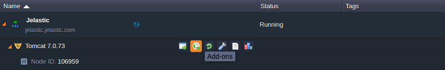

# Add-Ons

Cloud Scripting allows you to install a custom add-on either to a new environment, or to the existing one. You can develop your custom add-on in confines of another - *parent* manifest. Therefore, you need to state the add-on's installation type to *update* and declare essential properties within the *addons* section.  
   
You can install the developed add-on either by specifying a target [*nodeGroup*](/selecting-containers/#all-containers-by-group), or by calling the [*installAddon*](/actions/#installaddon) action.             

The following example illustrates the add-on's installation to a specific *nodeGroup* (layer).                          


```yaml
type: install
name: Addon installation

nodes:
  - nodeType: apache2
    addons: custom-addon-id
  - nodeType: mysql5

addons:
  - id: custom-addon-id
    name: Custom Addon
    onInstall:
      api [cp]: environment.control.RestartNodes
```


```json
{
  "type": "install",
  "name": "Addon installation",
  "nodes": [
    {
      "nodeType": "apache2",
      "addons": "custom-addon-id"
    },
    {
      "nodeType": "mysql5"
    }
  ],
  "addons": {
    "id": "custom-addon-id",
    "name": "Custom Addon",
    "onInstall": {
      "api [cp]": "environment.control.RestartNodes"
    }
  }
}
```



In the example above, the [Jelastic API](https://docs.jelastic.com/api/) ***RestartNodes*** method is executed after the environment creation is completed. The compute node is restarted at the end of the manifest installation procedure. Herewith, the add-on is installed, if the *parent* manifest's installation type is *install*. When the add-on is installed, the **Add-ons** tab for the corresponding compute node becomes available at the dashboard.                                    

                        
  
The following example illustrates the add-on's installation by calling the *installAddon* action. You can call this action for both *update* and *install* installation types of a *parent* manifest.                            


```yaml
type: install
name: Addon installation

onInstall:
  installAddon:
    id: custom-addon-id

addons:
  - id: custom-addon-id
    name: Custom Addon
    onInstall:
      createFile [cp]: /var/log/test.log
```


```json
{
  "type": "install",
  "name": "Addon installation",
  "onInstall": {
    "installAddon": {
      "id": "custom-addon-id"
    }
  },
  "addons": {
    "id": "custom-addon-id",
    "name": "Custom Addon",
    "onInstall": {
      "createFile [cp]": "/var/log/test.log"
    }
  }
}
```


Through this example, a new *test.log* file is created during the *onInstall* action execution. You can declare the add-on's expected behaviour within the *addons* section, while the *installAddon* action is needed to specify the appropriate add-on's identifier.              

## What's next?

- Find out how to handle [Custom Responses](/handling-custom-responses/)                       
- Explore how to customize [Visual Settings](/visual-settings/)                
- Examine a bunch of [Samples](/samples/) with operation and package examples                      
- See [Troubleshooting](/troubleshooting/) for helpful tips and specific suggestions
