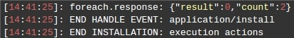

# Control Flows: Conditions and Iterations

**Comparison** and **Logical** operators are used in *conditional* statements and serve to test for `true` or `false`.

## Comparison Operators

The Comparison operators are used in logical statements to determine equality or difference between variables or values.

Let's assume that `x = 5`. The table below explains the comparison operators:

| Operator           | Description                         | Comparing |  Returns |
|--------------------|-------------------------------------|-----------|----------|
| ==                 | equal to                            | x == 8    | false    |
| ==                 | equal to                            | x == 5    | true     |
| ==                 | equal to                            | x == "5"  | true     |
|                    |                                     |           |          |
| ===                | equal value and equal type          | x === 5   | true     |
| ===                | equal value and equal type          | x === "5" | false    |
|                    |                                     |           |          |
| !=                 | not equal                           | x != 8    | true     |
|                    |                                     |           |          |
| !==                | not equal value or not equal type   | x !== 5   | false    |
| !==                | not equal value or not equal type   | x !== "5" | true     |
| !==                | not equal value or not equal type   | x !== 8   | true     |
|                    |                                     |           |          |
| >                  | grater than                         | x > 8     | false    |
| <                  | less than                           | x < 8     | true     |
| >=                 | grater than or equal to             | x >= 8    | false    |
| <=                 | less than or equal to               | x <= 8    | true     |

## Logical Operators

The logical operators are used to determine the logic between variables or values. Let's take that `x = 6` and `y = 3`. The table below explains the logical operators:

| Operator           | Description                         | Example                      |
|--------------------|-------------------------------------|------------------------------|
| &&                 | and                                 | (x < 10 && y > 1) is true    |
| ==                 | or                                  | (x == 5 || y == 5) is false  |
| ==                 | not                                 | !(x == y) is true            |


## Conditions

The main conditional statement is <b>*if*</b>. Within this parameter, all the available <a href="/placeholders/" target="_blank">placeholders</a> and their objective JavaScript  mappings can be used. 

For example
```
if ('${env.protocol}' == 'http')
```
or 
```
if (env.protocol == 'http')
```

The main iterable object is <b>*ForEach*</b>. Both <b>*if*</b> and <b>*ForEach*</b> can be of any nesting level.                                             

- If condition is specified incorrectly, the actions inside <b>*if*</b> statement are not executed. Herewith, the <a href="/troubleshooting/" target="_blank">Cloud Scripting Console</a> returns the <b>*‘invalid condition’*</b> message with the root cause explanation. The application installer proceeds to the next action.                            

- If condition is valid, but is not executed, the <b>*'condition is not met'*</b> message is logged.                                        

<b>Examples</b>    

* Comparing global variables


```yaml
type: update
name: Comparing global variables

globals:
  p1: 1
  p2: 2

onInstall:
  - if (globals.p1 < globals.p2):
      if (user.uid > 1):
        log: "## p1 < p2 and ${user.email} is not a platform owner"
```


```json
{
  "type": "update",
  "name": "Comparing global variables",
  "globals": {
    "p1": 1,
    "p2": 2
  },
  "onInstall": [
    {
      "if (globals.p1 < globals.p2)": {
        "if (user.uid > 1)": {
          "log": "## p1 < p2 and ${user.email} is not a platform owner"
        }
      }
    }
  ]
}
```



* Checking environment status


```yaml
onInstall:
  if (env.status == 1):
    log: "## Environment is running"
```


```json
{
  "onInstall": {
    "if (env.status == 1)": {
      "log": "## Environment is running"
    }
  }
}
```


     
* Checking Jelastic SSL status 


```yaml
onInstall:
  if(!${env.ssl}):
    log: "## SSL Disabled"
```


```json
{
  "onInstall": {
    "if(!${env.ssl})": {
      "log": "## SSL Disabled"
    }
  }
}
```



* Validating environment domain


```yaml
onInstall:
  if (/^env-/.test(env.domain)):
    log: "## Env domain begins with env-: ${env.domain}"
```


```json
{
  "onInstall": {
    "if (/^env-/.test(env.domain))": {
      "log": "## Env domain begins with env-: ${env.domain}"
    }
  }
}
```



* Checking compute node OS type and balancer presence


```yaml
onInstall:
  if (nodes.cp && nodes.cp[0].osType == 'LINUX'):
    log: "## Environment has compute node based on Linux"
    if (nodes.bl && nodes.bl[0].nodeType == 'nginx' && nodes.cp.length > 1):
      log: "## Environment has Nginx balancer and more than one compute node"
```


```json
{
  "onInstall": {
    "if (nodes.cp && nodes.cp[0].osType == 'LINUX')": [
      {
        "log": "## Environment has compute node based on Linux"
      },
      {
        "if (nodes.bl && nodes.bl[0].nodeType == 'nginx' && nodes.cp.length > 1)": {
          "log": "## Environment has Nginx balancer and more than one compute node"
        }
      }
    ]
  }
}
```



### Nested Conditions
  
Nesting of two <b>*if*</b> conditional statements - the first one is checking an environment for two compute nodes presence. If the nodes are available, the second one is checking the presence of the external IP address on the first balancer node and is logging the correspondent messages.          


```yaml
type: update
name: Nesting example

onInstall:
  if (${nodes.cp[1].id}):
    - cmd [${nodes.cp[1].id}]: echo "Environment consists of two compute nodes" >> /tmp/result.txt
    - if (/^[0-9]{2,3}.[0-9]{2,3}.[0-9]{2,3}.[0-9]{2,3}/.test("${nodes.bl[0].extips}")):
        cmd [${nodes.cp[0].id}]: echo "Balancer node with external IP address!" >> /tmp/result.txt
```


```json
{
  "type": "update",
  "name": "Nesting example",
  "onInstall": {
    "if (${nodes.cp[1].id})": [
      {
        "cmd [${nodes.cp[1].id}]": "echo \"Environment consists of two compute nodes\" >> /tmp/result.txt"
      },
      {
        "if (/^[0-9]{2,3}.[0-9]{2,3}.[0-9]{2,3}.[0-9]{2,3}/.test(\"${nodes.bl[0].extips}\"))": {
          "cmd [${nodes.cp[0].id}]": "echo \"Balancer node with external IP address!\" >> /tmp/result.txt"
        }
      }
    ]
  }
}
```



The operation result can be located within a <b>*result.txt*</b>  file that is automatically created in the master node (i.e. the first *cp* node) *<b>tmp</b>* directory.
```
Environment consists of two compute nodes
Balancer node with external IP address!
```

* Checking balancer stack type   


```yaml
type: update
name: Nginx stack

onInstall:
  if (nodes.bl[0].nodeType == 'nginx'):
    - script: |
        return { result: 0, error: "Environment balancer node is NGINX stack"};
```


```json
{
  "type": "update",
  "name": "Nginx stack",
  "onInstall": {
    "if (nodes.bl[0].nodeType == 'nginx')": [
      {
        "script": "return { result: 0, error: \"Environment balancer node is NGINX stack\"};"
      }
    ]
  }
}
```



### Else

In case the conditional statement should be complemented by the opposite comparison and respective action the ***else*** conditional operator can be accommodated.  



```yaml
type: install
name: '[CS:Conditions] - action "else"'

globals:
  a: 1
  b: 2

onInstall:
- log: "-- else condition test --"
- if (false):
    assert: false
- else:
    assert: true
- if (globals.a === 1):
    assert: true
- else:
    assert: false

- log: "-- nested conditions test --"
- if ('${globals.b}' === '2'):
    if (false):
      assert: false
- else:
    assert: false

- log: "-- conditions position test --"
- if (false):
    assert: true
- log: test
- else:
    assert: false

- log: "-- invalid condition test --"
- if ( ):
    assert: false
- else:
    assert: false
```


```json
{
  "type": "install",
  "name": "[CS:Conditions] - action 'else'",  
  "globals": {
    "a": 1,
    "b": 2
  },
  "onInstall": [
    {
      "log": "-- else condition test --"
    },
    {
      "if (false)": {
        "assert": false
      }
    },
    {
      "else": {
        "assert": true
      }
    },
    {
      "if (globals.a === 1)": {
        "assert": true
      }
    },
    {
      "else": {
        "assert": false
      }
    },
    {
      "log": "-- nested conditions test --"
    },
    {
      "if ('${globals.b}' === '2')": {
        "if (false)": {
          "assert": false
        }
      }
    },
    {
      "else": {
        "assert": false
      }
    },
    {
      "log": "-- conditions position test --"
    },
    {
      "if (false)": {
        "assert": true
      }
    },
    {
      "log": "test"
    },
    {
      "else": {
        "assert": false
      }
    },
    {
      "log": "-- invalid condition test --"
    },
    {
      "if ( )": {
        "assert": false
      }
    },
    {
      "else": {
        "assert": false
      }
    }
  ]
}
```



### Elif

An **elif** is a combination of ***if*** and ***else***. Similar to *else*, it extends the *if* statement to execute a different statement in case the original *if* expression evaluates to *FALSE*. However, unlike *else*, it will execute that alternative expression only if the *elif* conditional expression evaluates to *TRUE*. 
There may be several *elif* within the same *if* statement. The first *elif* expression (if several exist) that evaluates to *TRUE* would be executed and the others will be skipped.  



```yaml
type: install
name: '[CS:Conditions] - action "elif"'

globals:
  a: 1
  b: 2

onInstall:
- log: "-- elif positive test  --"
- if (globals.a == 2):
    assert: false
- elif (globals.a == 3):
    assert: false
- elif (globals.a == 1):
    assert: true
- elif (globals.a == 1):
    assert: false
- elif (globals.b == 2):
    assert: false
- else:
    assert: false

- log: "-- elif negative test  --"
- if (globals.a == 1):
    assert: true
- elif (globals.a == 1):
    assert: false
- elif (globals.a == 1):
    assert: false
```


```json
{
  "type": "install",
  "name": "[CS:Conditions] - action 'elif'",
  "globals": {
    "a": 1,
    "b": 2
  },
  "onInstall": [
    {
      "log": "-- elif positive test  --"
    },
    {
      "if (globals.a == 2)": {
        "assert": false
      }
    },
    {
      "elif (globals.a == 3)": {
        "assert": false
      }
    },
    {
      "elif (globals.a == 1)": {
        "assert": true
      }
    },
    {
      "elif (globals.a == 1)": {
        "assert": false
      }
    },
    {
      "elif (globals.b == 2)": {
        "assert": false
      }
    },
    {
      "else": {
        "assert": false
      }
    },
    {
      "log": "-- elif negative test  --"
    },
    {
      "if (globals.a == 1)": {
        "assert": true
      }
    },
    {
      "elif (globals.a == 1)": {
        "assert": false
      }
    },
    {
      "elif (globals.a == 1)": {
        "assert": false
      }
    }
  ]
}
```



### Single line *if* statement

Another ***if-else*** combination can be represented as a single ***if*** statement when multiple conditions are required to be checked and the statements nesting is not mandatory.
It is applicable if any condition or all of the conditions in the statement may lead to the same outcome. 
For example:



```yaml
type: install
name: '[CS:Conditions] - action single line "if"'

globals:
  a: 1
  b: 2

onInstall:
- log: "-- single line if test --"
- if ((globals.b == 2) && (globals.a == 1) && (globals.a == 1)):
    assert: true
    
- log: "-- another single line if test --"
- if (globals.a == 2 || globals.a == 3 || globals.a == 1):
    assert: true
```


```json
{
   "type": "install",
   "name": "[CS:Conditions] - action single line \"if\"",
   "globals": {
      "a": 1,
      "b": 2
   },
   "onInstall": [
      {
         "log": "-- single line if test --"
      },
      {
         "if ((globals.b == 2) && (globals.a == 1) && (globals.a == 1))": {
            "assert": true
         }
      },
      {
         "log": "-- another single line if test --"
      },
      {
         "if (globals.a == 2 || globals.a == 3 || globals.a == 1)": {
            "assert": true
         }
      }
   ]
}
```




## Iterations

### ForEach

The main iterable object is <b>*ForEach*</b> with the following map. 


```yaml
env:
  nodes: []
  contexts: []
  extdomains: []

nodes: {}
settings: {}
license: {}

event:
  params: {}
  response: {}

this: {}
```


```json
{
  "env": {
    "nodes": [],
    "contexts": [],
    "extdomains": []
  },
  "nodes": {},
  "settings": {},
  "license": {},
  "event": {
    "params": {},
    "response": {}
  },
  "this": {}
}
```


where:    

- `settings` *[optional]* - values of the fields that are predefined within a <a href="/visual-settings/" target="_blank">user settings form</a>          
- `license [optional]` - link to fetch parameters that are specified within the <a href="/visual-settings/" target="_blank">prepopulate</a> custom script. It enables to customize default field values and can be further initialized through the `$(license.{any_name}` <a href="/placeholders/" target="_blank">placeholder</a>  within a manifest.       
- `event [optional]` - object with <a href="/events/" target="_blank">events</a> that can be of two types, triggering a particular <a href="/actions/" target="_blank"> action</a> *before* or *after* the event execution       
- `this [optional]` - object with parameters that are transmitted within the procedure body. See the full list of available<a href="/placeholders/#procedure-placeholders" target="_blank"> placeholders</a> on this parameter.        

Iteration can be executed by <b>*env.nodes*</b>, <b>*nodes*</b>, <b>*env.contexts*</b>, and <b>*env.extdomains*</b> objects.                      

Iteration set by <b>*env.extdomains*</b>.


```yaml
forEach(env.extdomains):
  - writeFile:
      nodeGroup: cp
      path: /var/lib/jelastic/keys/${@i}.txt
      body: hello
```


```json
{
  "forEach(env.extdomains)": [
    {
      "writeFile": {
        "nodeGroup": "cp",
        "path": "/var/lib/jelastic/keys/${@i}.txt",
        "body": "hello"
      }
    }
  ]
}
```


where:    

- `@i` - default iterator name 
- `env.extdomains` - bound external domains 

Iteration set by <b>*env.contexts*</b>.


```yaml
forEach(env.contexts):
  writeFile [cp]:
    path: /var/lib/jelastic/keys/${@i.context}.txt
    body: 1
```


```json
{
  "forEach(env.contexts)": {
    "writeFile [cp]": {
      "path": "/var/lib/jelastic/keys/${@i.context}.txt",
      "body": "1"
    }
  }
}
```


where:  

- `env.contexts` -  list of contexts (applications) deployed to an environment                           

The example of scaling nodes.                             


```yaml
type: update
name: Scaling Example

onAfterScaleIn [nodeGroup:cp]: ScaleNodes

onAfterScaleOut [nodeGroup:cp]: ScaleNodes

actions:
  ScaleNodes:
    forEach(nodes.cp):
      cmd [bl]:
        - {commands to rewrite all Compute nodes internal IP addresses in balancer configs. Here balancer node is NGINX}
        - /etc/init.d/nginx reload
```


```json
{
  "type": "update",
  "name": "Scaling Example",
  "onAfterScaleIn[nodeGroup:cp]": "ScaleNodes",
  "onAfterScaleOut[nodeGroup:cp]": "ScaleNodes",
  "actions": {
    "ScaleNodes": {
      "forEach(nodes.cp)": {
        "cmd [bl]": [
          "{commands to rewrite all Compute nodes internal IP addresses in balancer configs. Here balancer node is NGINX}",
          "/etc/init.d/nginx reload"
        ]
      }
    }
  }
}
```


As a result of the *cmd* action, the compute nodes internal IP addresses are rewritten within balancer configs and NGINX balancer node is reloaded. The <b>*onAfterScaleIn*</b> and <b>*onAfterScaleOut*</b> events are executed immediately after adding or removing a compute node.   

### By All Nodes

Iteration by all nodes in an environment.    

Iteration set by <b>*env.nodes*</b>.


```yaml
forEach(env.nodes):
  cmd [${@i.id}]: echo ${@i.address} > /tmp/example.txt
```


```json
{
  "forEach(env.nodes)": {
    "cmd [${@i.id}]": "echo ${@i.address} > /tmp/example.txt"
  }
}
```


### By Compute Nodes

Iteration by compute nodes with a custom iterator name.


```yaml
forEach(cp:nodes.cp):
  cmd [${@cp.id}]: echo ${@cp.address} > /tmp/example.txt
```


```json
{
  "forEach(cp:nodes.cp)": {
    "cmd [${@cp.id}]": "echo ${@cp.address} > /tmp/example.txt"
  }
}
```


where:   
- `@cp [optional]` - custom iterator name. Also, target nodes can be set by type -*${@cp.nodeType}*, or group - *${@cp.nodeGroup}*.                                                    

Custom iterator name can be used for nesting cycles one into another.


```yaml
type: update
name: execution actions

onInstall:
  forEach(item:env.nodes):
    forEach(secondItem:env.nodes):
      log: ${@@item} - ${@@secondItem} - ${@}
```


```json
{
  "type": "update",
  "name": "execution actions",
  "onInstall": {
    "forEach(item:env.nodes)": {
      "forEach(secondItem:env.nodes)": {
        "log": "${@@item} - ${@@secondItem} - ${@}"
      }
    }
  }
}
```


where:   

- `${@}` - iterator number current loop  
- `${@@item}` - iterator number of the first loop 
- `${@@secondItem}` - iterator number of the second loop 

In this case, every environment node will have only one conjunction by <b>Node ID</b>.

The **ForEach** execution is recorded in the user console <a href="/troubleshooting/" target="_blank">log file</a> for convenient code debugging.           


<br>
<h2>What's next?</h2>        

- Read how to integrate your <a href="/custom-scripts/" target="_blank">Custom Scripts</a>                         

- Learn how to сreate your custom <a href="/addons/" target="_blank">Add-Ons</a>                                         

- Find out how to handle <a href="/handling-custom-responses/" target="_blank">Custom Responses</a>                       

- See how to customize <a href="/visual-settings/" target="_blank">Visual Settings</a>                   

- Examine a bunch of <a href="/samples/" target="_blank">Samples</a> with operation and package examples                           

- See the <a href="/troubleshooting/" target="_blank">Troubleshooting</a> for helpful tips and specific suggestions
