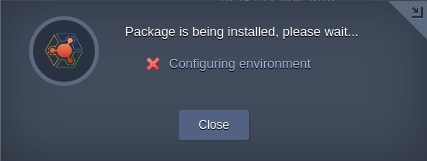
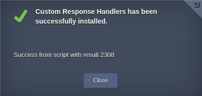

# Handling Custom Responses

The Cloud Scripting engine provides functionality to handle custom responses. This functionality is related to the action result codes that can be located within the [Virtuozzo Application Management Console Log Panel](/troubleshooting/) upon a corresponding action execution.                      

There are the following types of pop-up windows that emerge while custom responses are being handled:                    

- `info` - *information* pop-up window                

      

- `warning` - *warning* pop-up window with a custom message                
 
        

- `error` - *error* pop-up window          

          

- `success` - *successfull* result window.  
When the action is executed with the expected result code, the *success* window is displayed.  

                               

A **success** type has an optional parameter `email` - custom email can be sent after successful JPS installation. 

The *info*, *error* and *warning* pop-up windows emerge as a result of failed installation. The manifest installation is finished immediately, if any action returns the negative result code or code predefined in the *responses* block. Thus, the installation process is marked by the red cross like in the picture below.                        



The basic custom response message can be returned in one string via the **return** or **script** action as follows.                     


```yaml
type: update
name: response handlers

onInstall:
  return: Warning!
```


```json
{
  "type": "update",
  "name": "response handlers",
  "onInstall": {
    "return": "Warning!"
  }
}
```





```yaml
type: update
name: response handlers

onInstall:
  script: |
    return 'Warning!'
```


```json
{
  "type": "update",
  "name": "response handlers",
  "onInstall": {
    "script": "return 'Warning!'"
  }
}
```



In this case, the default response type is *error* and the response *warning* message is returned in a string.

It is possible to return a response with a predefined result type and with a custom message text via the **return** or **script** action.                  

The [*return*](/actions/#script) action.                  



```yaml
type: update
name: response handlers

onInstall:
  return:
    result: warning
    message: Warning!
    email: string
```


```json
{
    "type": "update",
    "name": "response handlers",
    "onInstall": {
        "return": {
          "result": "warning",
          "message": "Warning!",
          "email": "string"
        }
    }
}
```


{}
The *email* parameter is available only for the *success* response type. The email is delivered when an action is executed with the *success* response code.                         
{}

The *[script](/actions/#script)* action. 



```yaml
type: update
name: response handlers

onInstall:
  script: |
    return {"result": "warning", "message": "Warning!","email": "string"}
```


```json
{
  "type": "update",
  "name": "response handlers",
  "onInstall": {
    "script": "return {\"result\": \"warning\", \"message\": \"Warning!\",\"email\": \"string\"}"
  }
}
```



The *message* and *email* parameters support all the available [placeholders](/placeholders/). Thus, placeholders can be uploaded from any external source via the direct link or via the [baseUrl](/basic-configs/#relative-links).                          

When a response code with the *success* installation type is returned, two response objects impose one another. And the *success* text from the *response* object has higher priority than the *[success](/visual-settings/#success-text-customization)* text from the main manifest block.            

**Examples**                           

Here, the result code is with the *success* installation type, the message is '*Hello!!*' will be displayed at Virtuozzo Application Management dashboard, and the email message is '*success!!*' will be sent.


```yaml
type: update
name: response handlers

onInstall:
  script: |
    return {'result': 'success','message': 'Hello!!'}
success: success!!
```


```json
{
    "type": "update",
    "name": "response handlers",
    "onInstall": {
        "script": "return {'result': 'success','message': 'Hello!!'}"
    },
    "success": "success!!"
}
```



Here, the result code is with the *success* installation type, the message is '*Hello!!*', and the email message is '*Hello!!*'.                                             


```yaml
type: update
name: response handlers

onInstall:
  script: |
    return {'result': 'success','message': 'Hello!!', 'email': 'Hello!!'}
success: success!!
```


```json
{
    "type": "update",
    "name": "response handlers",
    "onInstall": {
        "script": "return {'result': 'success','message': 'Hello!!', 'email': 'Hello!!'}"
    },
    "success": "success!!"
}
```


The result message text can be localized according to the languages, available within the Virtuozzo Application Management.                   


```yaml
type: warning

message:
  en: Localized text
  es: Texto localizado
```


```json
{
  "type": "warning",
  "message": {
    "en": "Localized text",
    "es": "Texto localizado"
  }
}
```


If it is necessary to display the same response codes, you can add a *response* object where you define custom responses.                           

**Examples**

**File creation error**

The example below describes a creation of the same file twice and handling a response that is received as a result of such action execution. Consequently, the result code of this response will be defined as *4036*. Thus, all the actions with *4036* result are displayed via *error* pop-up window with a custom response text.


```yaml
type: update
name: Handling File Creation

onInstall:
  - createFile [cp]: /tmp/customDirectory
  - createFile [cp]: /tmp/customDirectory

responses:
  4036:
    type: error
    message: file path already exists
```


```json
{
  "type": "update",
  "name": "Handling File Creation",
  "onInstall": [
    {
      "createFile [cp]": "/tmp/customDirectory"
    },
    {
      "createFile [cp]": "/tmp/customDirectory"
    }
  ],
  "responses": {
    "4036": {
      "type": "error",
      "message": "file path already exists"
    }
  }
}
```



where: 

- `createFile` - predefined within the Cloud Scripting [action](/actions/#createfile)              
- `responses` - object (array) to describe custom responses     
- `type` - type of a pop-up window, emerging upon the response occurrence. The available values are: *error*, *warning*, *info*, *success*.       

The additional functionality is provided to display action responses using [*return*](/actions/) action.                         


```yaml
type: update
name: Custom Response Handlers

onInstall:
  script: |
    return {result : 1000};

responses:
  1000:
    type: warning
    message: Custom Warning message!
```


```json
{
  "type": "update",
  "name": "Custom Response Handlers",
  "onInstall": {
    "script": "return {result : 1000};"
  },
  "responses": {
    "1000": {
      "type": "warning",
      "message": "Custom Warning message!"
    }
  }
}
```



where:

- `script` - Cloud Scripting [action](/actions/#script) for executing *Javascript* or *Java* code (*Javascript* is set by default)                     
- `1000` - custom predefined result code for responses handling. It is returned from the *script* action in the *onInstall* block.        

If the result code is delivered via string, then the default result code is *11039*. Therefore, responses can be handled by the following outcoming string text.                                             


```yaml
type: update
name: Custom Response Handlers

onInstall:
  script: return 'error'

responses:
  error:
    type: info
    message: Custom Warning message!
```


```json
{
	"type": "update",
	"name": "Custom Response Handlers",
	"onInstall": {
		"script": "return 'error'"
	},
	"responses": {
		"error": {
			"type": "info",
			"message": "Custom Warning message!"
		}
	}
}
```



In all the other cases, when a custom response is not predefined within the *responses* block, the default pop-up window type is *error* with an output message.          

The response objects that are returned from custom scripts and predefined in the *response* block are imposed one to another. Thus, the response object from custom scripts has higher priority than responses in the *response* object.                    

**Example**


```yaml
type: update
name: Custom Response Handlers

onInstall:
  script: |
    return {'result': '2308', 'message': 'Success from script with result 2308'}

responses:
  2308:
    type: success
    message: Custom Success message!
```


```json
{
  "type": "update",
  "name": "Custom Response Handlers",
  "onInstall": {
    "script": "return {'result': '2308', 'message': 'Success from script with result 2308'}"
  },
  "responses": {
    "2308": {
      "type": "success",
      "message": "Custom Success message!"
    }
  }
}
```



The final *success* form is similar to the following one. 

                         

## What's next?

- Explore how to customize [Visual Settings](/visual-settings/)                                
- Examine a bunch of [Samples](/samples/) with operation and package examples        
- See [Troubleshooting](/troubleshooting/) for helpful tips and specific suggestions                 
- Find out the correspondence between [CS & Virtuozzo Application Management Versions](/virtuozzo-cs-correspondence/)
