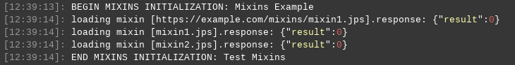

# Mixins
The **mixins** provide agility in Cloud Scripting allowing to include(mix) pieces of code from one manifest into another.  
The following sections can be mixed:  
  - `globals`  
  - `actions`  
  - `addons`  
  - `responses`  
  
The *mixins* section in JPS manifest can contain a description of both a single and an array of *mixins*.
In case there are included the identical *mixins* or recursive ones, the only first occurrence will be taken into the action. Also, the names were defined in the main manifest are of higher priority than those are in the *mixins*.   
main.jps 


```yaml
type: install
name: Mixins Example
baseUrl: https://example.com/mixins

mixins:
  - mixin1.jps
  - mixin2.jps
  
actions:
  mainAction:
    log: mainTest

onInstall:
  - mainAction
  - mixin1Action
  - mixin2Action
```


```json
{
  "type": "install",
  "name": "Mixins Example",
  "baseUrl": "https://example.com/mixins",
  "mixins": [
    "mixin1.jps",
    "mixin2.jps"
  ],
  "actions": {
    "mainAction": {
      "log": "mainTest"
    }
  },
  "onInstall": [
    "mainAction",
    "mixin1Action",
    "mixin2Action"
  ]
}
```



Where the Included mixins' code looks as follows:
mixin1.jps   


```yaml
mixins:
- https://example.com/mixins/mixin1.yaml

actions:
  mixin1Action:
    log: mixin1Action
```


```json
{
  "mixins": [
    "https://example.com/mixins/mixin1.yaml"
  ],
  "actions": {
    "mixin1Action": {
      "log": "mixin1Action"
    }
  }
}
```



mixin2.jps   


```yaml
actions:
  mixin2Action:
    log: mixin2Action
```


```json
{
  "actions": {
    "mixin2Action": {
      "log": "mixin2Action"
    }
  }
}
```



While performing  the example above, the result of mixins include will be displayed in the log before executing onInstall event:   



If the mixin could not be loaded, an ERROR will be displayed in the CS log indicating the reason (for example, file not found), and the response from the server will contain error code 11042. Once the *mixins* are loaded, in the main.jps example, you can use any action which is in *mixins*.
The mixin's baseURL is always overridden by the baseURL from the main manifest the mixin is included into.
