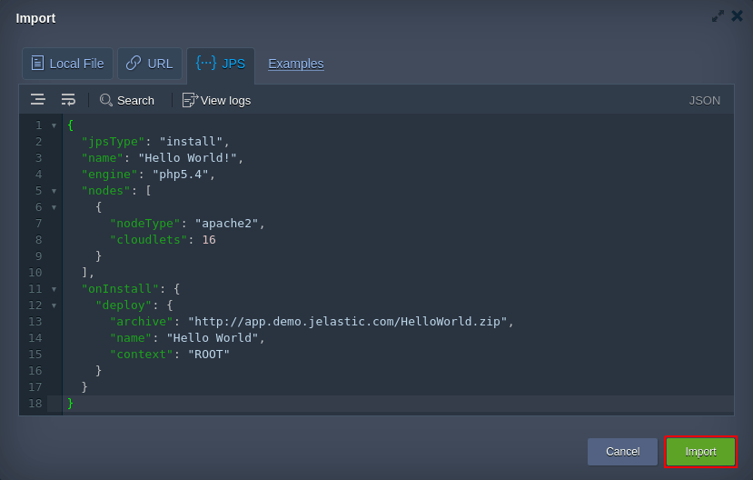
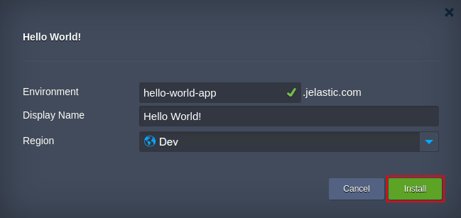
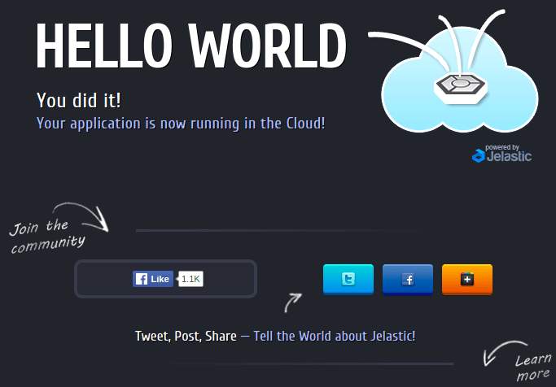

# Quick Start
    
This guide is designed to assist you with the first steps towards implementing the Cloud Scripting solutions.                                     

To give a try to Cloud Scripting right away, use a basic [Hello World](#hello-world-manifest-example) application sample, provided below.                                                                     

And to get up and ready with your own project, fulfill the following requirements:                                    

- decide upon a [scenario](/samples/) that will be delivered by means of CS                       
- define a set of [properties](/basic-configs/) properties</a>, essential for the proper application workflow                  
- declare the required properties within your [JPS manifest](/basic-configs/) file                      
- deploy the prepared manifest to a Platform via [import](#how-to-deploy-cs-solution-to-virtuozzo ) functionality                 

## Hello World Manifest Example

Hello World is a simple ready-to-go application that you can use as a start point in exploring Cloud Scripting possibilities.                                              


```yaml
type: install
name: Hello World!
engine: php5.4

nodes:
  nodeType: apache2
  cloudlets: 16

onInstall:
  deploy:
    archive: http://app.demo.jelastic.com/HelloWorld.zip
    name: Hello World
    context: ROOT
```


```json
{
  "type": "install",
  "name": "Hello World!",
  "engine": "php5.4",
  "nodes": {
      "nodeType": "apache2",
      "cloudlets": 16
  },
  "onInstall": {
    "deploy": {
      "archive": "http://app.demo.jelastic.com/HelloWorld.zip",
      "name": "Hello World",
      "context": "ROOT"
    }
  }
}
```



The current manifest states to create a new environment, handled with **Apache 2** application server on top of **PHP 5.4** engine. After that, the platform will fetch the archive with Hello World app from the specified URL and deploy it to the Apache **ROOT** context.                                   

## How to Deploy CS Solution to Virtuozzo

In order to give a try to *Hello World* sample from above (or deploy your own application), enter your [Virtuozzo Application Management](https://www.virtuozzo.com/paas-partners/) account and perform the following steps.                    

1.&nbsp;Click the **Import** button at the top pane of the dashboard.                                             

                        

2.&nbsp;Within the opened frame, switch to the **JPS** tab and paste the code provided above (for Hello World app).                      

               

{}
**Tip:** Subsequently, you can use this editor to adjust your manifest code on a fly. Clicking on the **Examples** string nearby will redirect you to [Virtuozzo Application Management JPS Collection](https://github.com/jelastic-jps) with numerous ready-to-go solutions (just import the link to the appropriate *manifest.jps* file to fetch the required one). Also, two more options for JPS deployment are available here:

- ***Local File*** - to upload the locally stored manifest
- ***URL*** - to specify direct link to the required file        
{}

To proceed, click on **Import** in the bottom-right corner.                   

3.&nbsp;Within the installation confirmation window, specify domain name for a new **Environment**, set a **Display Name** (i.e. [alias](https://www.virtuozzo.com/application-management-docs/environment-aliases/)) for it and select the preferred [region](https://www.virtuozzo.com/application-management-docs/environment-regions/) (if available).                  

                                        

4.&nbsp;Once the import is completed, you’ll get notification about successful package installation.                                                                              

               

Now you can **Open** your new environment in a **browser** and check the result.                         

                                   

Just in the same way, you can build and run the solution you need - from frequent tasks automation to implementing complex CI/CD flows and clustering configurations.                               

## Best Practises

- For advanced coding possibilities, use either [JSON Editor Online](http://jsoneditoronline.org/) with automatic formatting and syntax highlighting or [YAML](http://www.yaml.org/) parser (depending on the syntax you prefer to work with)                               
- Leverage [GitHub](https://github.com/) to store and manage your projects, manifests and scripts all together                              
- Explore [Virtuozzo Application Management Samples](/samples/) to benefit on preliminary composed operation and package examples                            

## What's next?

- [Basic Configs](/basic-configs/) - learn the minimum basis of any JSP manifest and find out about the differences between *Install* and *Update* package types                                                         
- [Actions](/actions/) - define the required configurations and application behavior with a set of prescribed procedures                                                           
- [Custom Scripts](/custom-scripts/) - integrate your own scripts, written in either *Java*, *Javascript* or *PHP*, to subsequently execute them within containers                                                              
- [Events](/events/) - automate application workflow by binding actions to particular application lifecycle events                                                     
- [Visual Settings](/visual-settings/) - customize your package visual layout                                                             
- [Placeholders](/placeholders/) - specify automatically substituted parameters for the required data to be fetched during installation                 
- [Troubleshooting](/troubleshooting/) - appeal to this guide if you face any issue while working with Cloud Scripting
