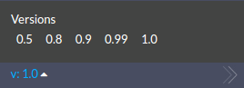

# Virtuozzo Application Management & CS Correspondence

Starting with the 6.0 Virtuozzo Application Management release, the Cloud Scripting and platform versions are the same. Use the documentation version that matches your platform version.

{}
The Virtuozzo Application Management version can be checked either at your dashboard, or within the [Virtuozzo Cloud Union](https://www.virtuozzo.com/application-platform-partners/) page, depending on your hosting provider. The Cloud Scripting version can be chosen from the version dropdown in the sidebar of the present documentation.
{}TODO: Verify: version.png shows the version switcher of the old MkDocs site; retake on the Hugo site.{}

{}
