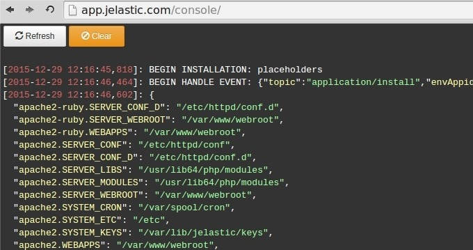
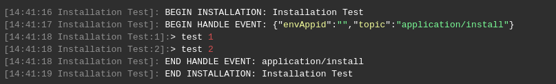
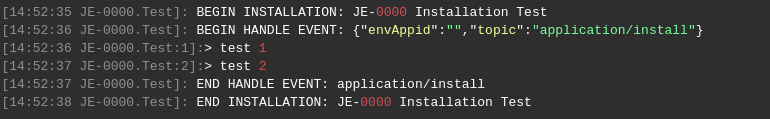
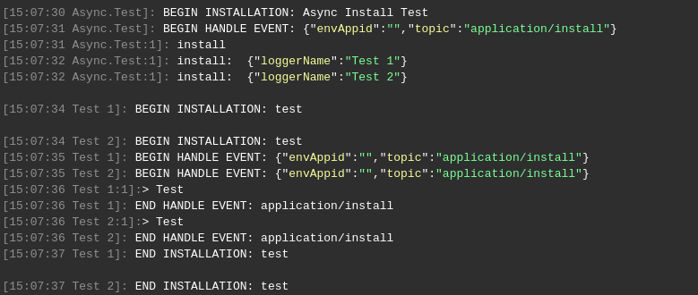
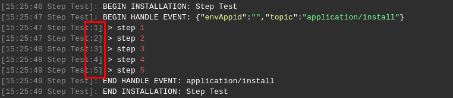
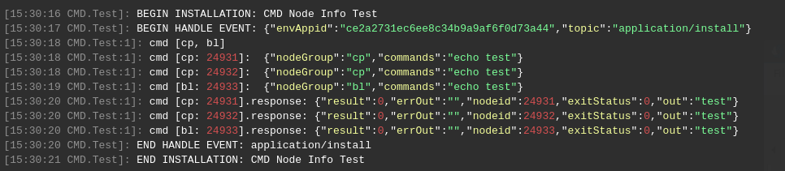
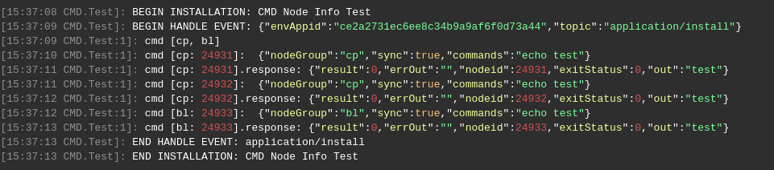
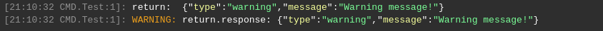

# Troubleshooting

Run into trouble with Cloud Scripting? Here are some helpful tips and specific suggestions for troubleshooting as follows:                             

* Log in to your Virtuozzo Application Management dashboard and open the link of the following type in a new browser tab.                            

    *http://app.{HOSTER_URL}/console/*                       
    
    Here, substitute ***{HOSTER_URL}***  with the platform domain of your hosting provider (see the last column of the table within the [Hosters Info](https://www.virtuozzo.com/application-management-docs/paas-hosting-providers/) page).                                           
* In the opened browser tab, you will see the Cloud Scripting execution log.                                                               
    
          

{}
The maximum size of the log is 1 MB. The log will be truncated or overwritten, if this limit is exceeded.
{}

Below, you can find some samples of editing custom information to the log:                      

- outputting a single [placeholder](/placeholders/) value                     



```yaml
type: update
name: LogTest

onInstall:
  log:
    - Hello
    - ${user.email}
```


```json
{
  "type": "update",
  "name": "LogTest",
  "onInstall": {
    "log": [
      "Hello",
      "${user.email}"
    ]
  }
}
```



- outputting all the placeholders              



```yaml
type: update
name: LogTest

onInstall:
  log: ${placeholders}
```


```json
{
  "type": "update",
  "name": "LogTest",
  "onInstall": {
    "log": "${placeholders}"
  }
}
```



All dynamic placeholders in *\${placeholders}* value are updated immediately after any action. Also placeholders will be updated automatically before displaying \${placeholders} value into console.

- outputting from a script             



```yaml
type: update
name: LogTest

onInstall:
  script:
    type: js
    script: "http://example.com/script.js"

actions:
  - myaction:
      log: ${this.message}
```


```json
{
  "type": "update",
  "name": "LogTest",
  "onInstall": {
    "script": {
      "type": "js",
      "script": "http://example.com/script.js"
    }
  },
  "actions": [
    {
      "myaction": {
        "log": "${this.message}"
      }
    }
  ]
}
```



`script.js` body:      

```javascript
var message = 'Hello';

return { 
    result: 0, 
    onAfterReturn: {
        call: [{
            action: 'myaction', 
            params: {
                message: message
            } 
        }, {
            action: 'myaction',
            params: {
                message: 'World !'
            }
        }] 
    } 
};
```

## loggerName

When installing any JPS, the logger name is displayed next to the time in each line of the log.
By default, the name of the logger is determined by the parameter *name* inside the JPS manifest:  


If the parameter *name* consists of more than two words, the name of the logger is formed by the first and last word with a dot as a delimiter:  


If you start the asynchronous installation of several identical JPSs, the name of logger may be overridden with **loggerName** parameter for each JPS in order to distinguish different JPS installation logs.  

- inside *install* action:
Example 1  
```
install:
  - jps: https://example.com/manifest.jps
    loggerName: Test 1

  - jps: https://example.com/manifest.jps
    loggerName: Test 2
```
Example 2  
```
install:
  - loggerName: Test 1
    jps: 
      type: install
      name: test
      onInstall: 
        log: Test    

  - loggerName: Test 2
    jps:
      type: install
      name: test
      onInstall: 
        log: Test
```


- with parameter of API request:  
```
api.marketplace.jps.Install({
  jps: "https://example.com/manifest.jps",
  loggerName: "Test 1"
});
```

## Current Step

To simplify debugging, the number of the current step is added to the logs. As you can see from the examples above, the step number follows the logger name and a colon.



## separate log for each node in group

In case the engine splits action execution into separate requests, the logging is performed for each node separately. For example:  

- asynchronous execution
```
cmd [cp, bl]: echo test
```


- synchronous execution  
```
sync: true
cmd [cp, bl]: echo test
```


## warning

The warnings are highlighted with orange.  
```
onInstall:
  return:
    type: warning
    message: Warning message!
```


## What's next?


- Find out the correspondence between [CS & Virtuozzo Application Management Versions](/virtuozzo-cs-correspondence/)          


<!--## Logging-->
<!--Work in progress...-->
<!--
add example 
2 procedures:
- log - public_html/cs.txt (do not forget to limit log) 
- getLogLink 
-->


<!--## Checking event subscribers list-->
<!--Work in progress...-->
<!-- think how to do that -->
