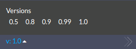

# Virtuozzo Application Platform & CS Correspondence {#virtuozzo-cs-correspondence}

The table below displays dependencies between Cloud Scripting and the Virtuozzo Application Platform versions within the same <a href="https://www.virtuozzo.com/application-platform-partners/" target="_blank">hosting provider</a> platform.



Starting with the 6.0 Virtuozzo Application Platform release, the Cloud Scripting and platform versions are the same.

{}

The Virtuozzo Application Platform version can be checked either at your dashboard, or within the <a href="https://www.virtuozzo.com/application-platform-partners/" target="_blank">Virtuozzo Cloud Union</a> page, depending on your hosting provider. The Cloud Scripting version can be chosen at the bottom of the page within the present documentation.                
          
    

{}

